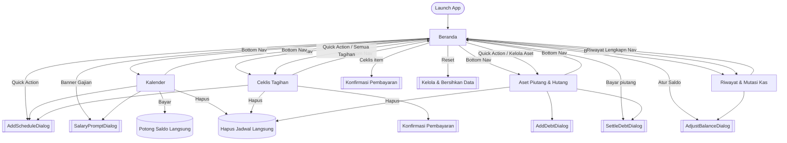

# DESIGN_CONTEXT.md

> **Dokumen ini adalah hasil analisis source code, bukan rencana desain.**
> Semua pernyataan di bawah menggambarkan **kondisi implementasi saat ini** dari project Android yang ada di repository ini.
> Sesuatu yang tidak dapat dibuktikan dari kode ditandai secara eksplisit dengan `Unknown / Requires Product Decision` atau `Not currently handled`.
>
> **Snapshot teknis**
> - Nama module: `Pencatat Keuangan` (`settings.gradle.kts` → `rootProject.name`, `res/values/strings.xml` → `app_name`)
> - Namespace: `com.example` · Application ID: `com.aistudio.pencatatkeuangan.vkmzla`
> - Platform: Android native, **Jetpack Compose + Material 3**
> - `minSdk 24`, `targetSdk 36`, `compileSdk 36`, `versionName 1.0`
> - Backend: **Room (SQLite lokal, offline)** — tidak ada network call / login
> - Navigasi: **bukan** Navigation-Compose. Navigasi = state `currentTab` di `MainActivity`
> - Bahasa UI: **Indonesia** (hardcoded di string literal, bukan resource)

---

## 1. PRODUCT OVERVIEW

**Nama aplikasi**
`Pencatat Keuangan` — subtitle di header beranda: "Layanan Keuangan & Kas Mandiri".

**Tujuan aplikasi**
Aplikasi pencatat keuangan pribadi 100% offline untuk memantau saldo kas, jadwal pemasukan/pengeluaran rutin, tagihan, serta piutang dan hutang ke orang lain.

**Masalah yang ingin diselesaikan** (diambil dari teks UI + `implementation_plan.md`)
- Saldo kas berubah tanpa diketahui penyebabnya → setiap perubahan wajib punya alasan/catatan yang tercatat di riwayat.
- Gaji tidak selalu masuk tepat waktu → aplikasi **tidak** menambah saldo otomatis; user harus mengonfirmasi penerimaan.
- Tagihan bulanan berulang mudah terlupa → disediakan ceklis tagihan yang menghilang otomatis saat sudah dibayar dan muncul kembali pada siklus berikutnya.
- Uang yang dipinjam orang lain tidak terlihat dalam saldo kas → dicatat sebagai **aset piutang terpisah** dari saldo kas.

**Target pengguna** (dari `implementation_plan.md`)
Individu / pekerja dengan siklus gaji 2 mingguan atau bulanan, serta pengelola keuangan mandiri yang butuh pencatatan uang tunai dan piutang.

**Fungsi utama yang benar-benar ada**
1. Kartu saldo kas + rincian piutang, hutang, dan kekayaan bersih.
2. Jadwal finansial berulang (sekali / 2 mingguan / bulanan / custom N hari) untuk pemasukan dan pengeluaran.
3. Prompt konfirmasi gajian ("Waktunya Gajian!") dengan opsi ubah nominal aktual + alasan.
4. Ceklis pembayaran tagihan, termasuk opsi bayar beberapa periode sekaligus.
5. Penyesuaian saldo kas manual dengan catatan alasan.
6. Pencatatan piutang (aset) dan hutang (kewajiban) dengan pelunasan penuh atau cicilan.
7. Kalender bulanan interaktif dengan indikator dot jadwal.
8. Riwayat mutasi kas dengan filter.
9. Reset / pembersihan data (mulai dari Rp 0 atau menyisakan 1 contoh tagihan).

**Konsep utama produk**
> "Tidak ada transaksi siluman." Setiap mutasi saldo punya jejak (alasan/catatan), dan jadwal rutin tidak pernah mengeksekusi saldo tanpa konfirmasi sadar dari pengguna.

**Yang tidak diketahui**
- Nama brand/pemilik produk: `Unknown / Requires Product Decision`
- Rencana monetisasi: `Unknown / Requires Product Decision`
- `metadata.json` mendeklarasikan `MAJOR_CAPABILITY_SERVER_SIDE_GEMINI_API` dan dependency `firebase-ai` sudah terpasang, tetapi **tidak ada satu pun kode fitur AI** di dalam project. Apakah fitur AI direncanakan: `Unknown / Requires Product Decision`.

---

## 2. CURRENT APP STRUCTURE

Struktur UI yang benar-benar ada (semua konten berupa Composable Jetpack Compose, bukan Android `Fragment`/`Activity` terpisah):

```
App (MainActivity → PencatatKeuanganTheme → PencatatKeuanganApp)
│
├── Scaffold
│   ├── content (Box dengan innerPadding)
│   │   └── 5 tab yang ditukar via `when (currentTab)`
│   │       ├── 1. Beranda (HomeScreen)            ← default tab
│   │       │   ├── Header biru "PENCATAT KEUANGAN" (fixed, tidak ikut scroll)
│   │       │   │   ├── Ikon + Judul + Subjudul
│   │       │   │   ├── Chip tanggal hari ini
│   │       │   │   └── Tombol "Reset" (kelola data)
│   │       │   ├── Banner Gajian (kondisional, jika ada jadwal gaji jatuh tempo)
│   │       │   ├── Kartu Saldo (gradient) + Tombol "Atur Saldo"
│   │       │   ├── Quick Actions: Jadwal Gaji | Ceklis Tagihan | Catat Piutang
│   │       │   ├── Section "Tagihan Perlu Dibayar (n)" (maks 3 item)
│   │       │   ├── Section "Aset Piutang Aktif (n)" (maks 2 item)
│   │       │   ├── Kartu status "Semua Tanggungan Terkendali" (jika keduanya kosong)
│   │       │   └── Section "Mutasi Rekening & Kas Terkini" (maks 5 item)
│   │       │
│   │       ├── 2. Kalender (CalendarScreen)
│   │       │   ├── Header biru "KALENDER FINANSIAL" + tombol "Hari Ini"
│   │       │   ├── Kartu Navigasi Bulan (prev/next + nama bulan)
│   │       │   ├── Grid Kalender 7 kolom (Sen–Min) + dot indikator
│   │       │   ├── Legend dot (Gajian/Pemasukan, Tagihan/Pengeluaran)
│   │       │   ├── Header "Agenda <tanggal>" + tombol "Tambah"
│   │       │   ├── Daftar jadwal pada tanggal terpilih (atau empty state)
│   │       │   ├── Section "Daftar Rutinitas Finansial Aktif"
│   │       │   └── Floating Action Button (+)
│   │       │
│   │       ├── 3. Ceklis (ChecklistScreen)
│   │       │   ├── Header biru "CEKLIS TAGIHAN" + tombol "Tambah"
│   │       │   ├── Kartu Ringkasan "Tagihan Perlu Dibayar Sekarang"
│   │       │   ├── 3 FilterChip tab: Perlu Bayar | Bulan Depan | Selesai
│   │       │   ├── Daftar item sesuai tab (masing-masing punya empty state)
│   │       │   └── Floating Action Button (+)
│   │       │
│   │       ├── 4. Aset / Hutang (DebtAssetScreen)
│   │       │   ├── Header biru "ASET PIUTANG & HUTANG" + tombol "Catat Baru"
│   │       │   ├── Kartu Ringkasan (Total Piutang | Total Hutang | Saldo Kas | Kekayaan)
│   │       │   ├── 3 FilterChip tab: Piutang | Hutang | Lunas
│   │       │   ├── Kartu item piutang/hutang (atau empty state)
│   │       │   └── Floating Action Button (+)
│   │       │
│   │       └── 5. Riwayat (HistoryScreen)
│   │           ├── Header biru "RIWAYAT & MUTASI KAS" + tombol "Atur Saldo"
│   │           ├── Baris FilterChip (horizontal scroll): Semua | Pemasukan | Pengeluaran | Penyesuaian
│   │           ├── Daftar kartu transaksi (atau empty state)
│   │           └── (tidak ada FAB)
│   │
│   └── bottomBar → NavigationBar (5 item, selalu terlihat)
│
├── Dialog global (dirender di level App, dipicu Quick Action beranda)
│   ├── AddScheduleDialog  ("Jadwal Gaji / Pemasukan")
│   └── AddDebtDialog
│
└── Dialog screen-level (dirender di dalam masing-masing Screen)
    ├── AdjustBalanceDialog        (Beranda, Riwayat)
    ├── SalaryPromptDialog         (Beranda, Kalender)
    ├── SettleDebtDialog           (Beranda, Aset/Hutang)
    ├── AddScheduleDialog          (Kalender, Ceklis)
    ├── AddDebtDialog              (Aset/Hutang)
    ├── AlertDialog "Konfirmasi Pembayaran Tagihan"  (inline di Beranda)
    ├── AlertDialog "Konfirmasi Pembayaran Tagihan"  (inline di Ceklis, duplikat)
    └── AlertDialog "Kelola & Bersihkan Data"        (inline di Beranda)
```

**Bottom navigation (selalu tampil di semua tab)**

| Label | Icon (selected / unselected) | testTag | Target |
|---|---|---|---|
| Beranda | `AccountBalanceWallet` (Filled/Outlined) | `nav_home` | HomeScreen |
| Kalender | `CalendarMonth` | `nav_calendar` | CalendarScreen |
| Ceklis | `Checklist` | `nav_checklist` | ChecklistScreen |
| Aset/Hutang | `Handshake` | `nav_debt` | DebtAssetScreen |
| Riwayat | `History` | `nav_history` | HistoryScreen |

---

## 3. SCREEN INVENTORY

### Screen: Beranda (Home)

**Purpose**
Dashboard utama: menampilkan posisi keuangan (kas, piutang, hutang, kekayaan bersih), hal-hal yang butuh perhatian hari ini (gajian & tagihan), dan mutasi terakhir.

**Entry Point**
Tab default saat aplikasi dibuka, atau tab "Beranda" di bottom navigation, atau tombol back dari tab lain.

**UI Components**
- `BankingHomeHeader` — Surface biru, ikon `AccountBalance`, judul "PENCATAT KEUANGAN", subjudul, chip tanggal hari ini (ikon `CalendarMonth`), tombol `Reset` (ikon `RestartAlt`).
- `SalaryAlertBanner` — kartu putih border biru, badge "GAJIAN TIBA", judul + nominal jadwal, tombol "Konfirmasi".
- `BankingBalanceCard` — kartu gradient navy→blue dengan watermark `Canvas` circle, label "Total Saldo Kas", tombol "Atur Saldo" (ikon `Edit`), angka saldo besar, sub-panel gelap berisi "Aset Piutang (Di Orang)", "Tanggungan Hutang", dan "Kekayaan Bersih (Kas + Piutang - Hutang)".
- `BankingQuickActions` → 3 × `QuickActionButton` (label + ikon dalam lingkaran: Jadwal Gaji / Ceklis Tagihan / Catat Piutang).
- `SectionHeader` — judul kiri + teks aksi kanan berwarna biru yang bisa di-tap.
- `HomeExpenseChecklistItem` — Card dengan `Checkbox` (selalu unchecked), judul, "Jatuh tempo: d MMM • <catatan>", nominal merah, label "Ceklis bayar".
- `HomePiutangItem` — Card dengan ikon `Handshake`, nama orang, "Sisa: Rp …", catatan, tombol "Bayar".
- Kartu status "Semua Tanggungan Terkendali" (ikon `CheckCircle`).
- `BankingTransactionRowItem` — ikon panah naik/turun, judul, catatan, tanggal-waktu, nominal bertanda.

**Displayed Data**
- `cashBalance`, `totalPiutang`, `totalHutang`, `netWorth`
- `activeSalaryPrompts.firstOrNull()` → judul, nominal, catatan pengingat
- `duePendingExpenses` (maks 3 ditampilkan, hitungan judul memakai jumlah total)
- Piutang aktif (`type == PIUTANG && !isFullySettled`), maks 2 ditampilkan
- `recentTransactions` (maks 5, sumber: 15 transaksi terbaru dari DAO)
- Tanggal hari ini (`DateUtils.formatDateIndo`)

**User Actions**
- tap banner/tombol "Konfirmasi" → buka `SalaryPromptDialog`
- tap "Atur Saldo" → buka `AdjustBalanceDialog`
- tap `Checkbox` / area "Ceklis bayar" → buka AlertDialog konfirmasi pembayaran
- tap "Bayar" pada piutang → buka `SettleDebtDialog`
- tap Quick Action → dialog global / pindah tab
- tap "Semua Tagihan" / "Kelola Aset" / "Riwayat Lengkap" → pindah tab
- tap "Reset" → AlertDialog kelola data (bersihkan semua / sisakan 1 contoh)
- scroll (LazyColumn)

**Navigation**
- "Ceklis Tagihan" / "Semua Tagihan" → tab Ceklis
- "Catat Piutang" / "Kelola Aset" → tab Aset/Hutang
- "Riwayat Lengkap" → tab Riwayat
- "Jadwal Gaji" → dialog AddScheduleDialog (mode pemasukan)
- (tidak ada cara masuk ke tab Kalender dari beranda selain bottom nav)

**States**
- Default (ada saldo/tagihan/piutang)
- Empty bagian: judul section "Tagihan…" dan "Aset Piutang…" **disembunyikan total** bila kosong
- Empty gabungan: kartu "Semua Tanggungan Terkendali"
- Empty transaksi: teks "Belum ada transaksi tercatat."
- Loading: tidak ada indikator (state awal `FinancialUiState()` dengan angka Rp 0 sampai Room mengirim data)
- Error: tidak ada
- `isInitialized` ada di state tetapi **tidak dipakai** oleh UI

**Current UX Problems**
- Hitungan di judul section memakai jumlah **total**, sedangkan daftar hanya menampilkan 3 item → angka bisa tidak cocok dengan yang terlihat.
- `Checkbox` selalu `checked = false` dan hanya berfungsi sebagai pemicu dialog, sehingga tidak pernah terlihat "tercentang".
- Loading state tidak ada: saat pertama dibuka, kartu saldo sempat tampil `Rp 0` sebelum data Room termuat.
- Tombol `Reset` di header beranda mudah tertekan dan membuka aksi destruktif (meski ada konfirmasi di dalam dialog).

---

### Screen: Kalender (Calendar)

**Purpose**
Menampilkan jadwal finansial dalam konteks penanggalan nyata dan memungkinkan pembuatan/pembayaran jadwal per tanggal.

**Entry Point**
Tab "Kalender" di bottom navigation.

**UI Components**
- Header biru "KALENDER FINANSIAL", subjudul, tombol "Hari Ini".
- Kartu Navigasi Bulan: `IconButton` prev (`ArrowBack`), teks "MMMM yyyy" berwarna primary, `IconButton` next (`ArrowForward`).
- Baris header hari: Sen, Sel, Rab, Kam, Jum, Sab, Min (`labelSmall`, SemiBold).
- `CalendarDayCell` — kotak `aspectRatio(1f)`, radius 12dp, angka tanggal, hingga 2 dot 5dp (hijau = pemasukan, merah = pengeluaran).
- `DotLegend` × 2.
- Header "Agenda <d MMMM yyyy>" + subteks "n jadwal di tanggal ini" + tombol "Tambah" (ikon `Add`).
- `ScheduleCardItem` — ikon lingkaran, judul, "catatan • frekuensi", nominal, aksi `Terima` / badge `Belum Tiba` / `Bayar`, dan `IconButton` hapus.
- `RecurringOverviewCard` — ikon `Repeat`, "judul (nominal)", "frekuensi • Jatuh tempo: d MMM", tombol hapus.
- Empty state agenda: ikon `Event` + "Tidak ada jadwal finansial di tanggal ini." + `OutlinedButton` "Buat Jadwal Baru di Tanggal Ini".
- `FloatingActionButton` biru (ikon `Add`).

**Displayed Data**
- `currentCalendarYear`, `currentCalendarMonth`, `selectedCalendarDate`
- Grid hari dari `DateUtils.getMonthDays()` (termasuk padding bulan sebelum/sesudah)
- Jadwal milik tanggal terpilih (`nextDueDate` = tanggal terpilih)
- Seluruh jadwal berulang (`recurrence != ONCE`)
- Per hari: ada pemasukan? ada pengeluaran?

**User Actions**
- tap tanggal → pilih tanggal (state `selectedCalendarDate`)
- tap prev/next bulan → ubah bulan (tidak mengubah tanggal terpilih)
- tap "Hari Ini" → set tanggal terpilih = hari ini (bulan **tidak** ikut berubah)
- tap "Tambah" / FAB → `AddScheduleDialog` dengan tanggal awal = tanggal terpilih
- tap "Terima" (hanya muncul bila waktu jadwal sudah tiba) → `SalaryPromptDialog`
- tap "Bayar" → pembayaran tagihan **langsung tanpa dialog konfirmasi**
- tap ikon hapus → hapus jadwal **tanpa konfirmasi**
- scroll

**Navigation**
- Tetap di tab Kalender; semua aksi berupa dialog atau mutasi data.
- Tidak ada navigasi ke detail jadwal.

**States**
- Default
- Selected day (kotak biru penuh, teks putih, dot putih)
- Today (background biru 12%, border biru 1dp, teks biru bold)
- Day outside current month (`outline` 50% alpha)
- Day with income dot / expense dot / both
- Agenda empty
- Recurring list empty
- "Belum Tiba" (pemasukan yang jadwalnya belum tiba → tombol terkunci, ditampilkan sebagai badge)
- Loading / Error: tidak ada

**Current UX Problems**
- Bayar tagihan dari kalender **tanpa dialog konfirmasi**, padahal dari Beranda/Ceklis ada dialog → pola interaksi berbeda untuk fungsi yang sama (aksi destruktif ke saldo).
- "Hari Ini" hanya mengubah tanggal terpilih, tidak memindahkan grid kalender ke bulan berjalan bila user sedang melihat bulan lain.
- Hapus jadwal tanpa konfirmasi dan tanpa undo.
- Filter bulan memakai `remember` biasa sehingga perubahan bulan tetap tersimpan di ViewModel (aman), tetapi state dialog hilang saat rotasi.

---

### Screen: Ceklis Tagihan (Checklist)

**Purpose**
Daftar kerja pembayaran tagihan: apa yang perlu dibayar sekarang, apa yang sudah lunas untuk periode ini, dan riwayat tagihan yang sudah selesai.

**Entry Point**
Tab "Ceklis" di bottom navigation, atau Quick Action "Ceklis Tagihan" / link "Semua Tagihan" dari Beranda.

**UI Components**
- Header biru "CEKLIS TAGIHAN", subjudul "Tagihan lunas otomatis hilang hingga siklus berikutnya", tombol "Tambah".
- Kartu Ringkasan: ikon lingkaran (`Checklist` merah atau `CheckCircle` hijau), label "Tagihan Perlu Dibayar Sekarang:", nominal besar, subteks jumlah item atau "Semua tagihan periode ini telah lunas!".
- 3 × `FilterChip`: "Perlu Bayar (n)", "Bulan Depan (n)", "Selesai (n)".
- `DueExpenseRow` — `Checkbox` (unchecked, uncheckedColor merah), judul, "Jatuh tempo: d MMM • catatan", nominal merah, label "Ceklis bayar", `IconButton` hapus.
- Empty state tab Perlu Bayar: kartu dengan ikon `CheckCircle` hijau, "Semua Tagihan Bulan Ini Lunas!", penjelasan, `OutlinedButton` "Lihat Jadwal Bulan Depan (n)".
- `UpcomingExpenseRow` — ikon `Schedule` dalam lingkaran biru, judul, "Sudah lunas bulan ini • Jatuh tempo: d MMMM yyyy", nominal, tombol hapus.
- Teks penjelas konteks tab Bulan Depan.
- `CompletedExpenseRow` — ikon `CheckCircle` hijau, judul, "Telah lunas (<tanggal>)", nominal, tombol hapus.
- Empty state Selesai: teks "Belum ada riwayat tagihan selesai."
- AlertDialog "Konfirmasi Pembayaran Tagihan" (chip 1/2/3/6 Bulan, kartu total potongan + saldo kas saat ini, tombol "Ceklis & Potong Saldo" / "Batal").
- `AddScheduleDialog` (tipe terkunci = pengeluaran, judul "Tambah Tagihan Baru").
- `FloatingActionButton` biru.

**Displayed Data**
- `duePendingExpenses` (expense belum selesai; `ONCE` selalu masuk, berulang masuk bila `nextDueDate <= now + 7 hari`)
- `upcomingExpenses` (berulang dengan `nextDueDate > now + 7 hari`)
- `schedules` dengan `type == EXPENSE && isCompleted`
- `cashBalance` (di dalam dialog konfirmasi)
- Total `dueList.sumOf { nominal }`

**User Actions**
- tap tab chip → ganti daftar
- tap `Checkbox` / teks → buka dialog konfirmasi pembayaran
- pilih jumlah bulan pada chip (1/2/3/6)
- tap "Ceklis & Potong Saldo" → potong saldo, catat transaksi, geser `nextDueDate`
- tap "Tambah" / FAB → `AddScheduleDialog` (pengeluaran)
- tap ikon hapus → hapus tagihan **tanpa konfirmasi**
- tap "Lihat Jadwal Bulan Depan" pada empty state → pindah ke tab 1
- scroll

**Navigation**
- Tidak ada perpindahan screen; hanya perpindahan tab internal.

**States**
- Tab Perlu Bayar: ada isi / kosong
- Tab Bulan Depan: ada isi / kosong
- Tab Selesai: ada isi / kosong
- Dialog: chip terpilih (1/2/3/6), recurring vs sekali
- Loading / Error: tidak ada

**Current UX Problems**
- Dua implementasi dialog "Konfirmasi Pembayaran Tagihan" yang berbeda (Beranda: 1/2/3 bulan; Ceklis: 1/2/3/6 bulan, plus informasi saldo kas) → duplikasi & inkonsistensi.
- Pilihan periode hanya tersedia untuk tagihan berulang; untuk `ONCE` tidak ada opsi apa pun (wajar secara logika, tapi tidak dijelaskan ke user).
- Menandai "selesai" mencampur dua konsep: tagihan `ONCE` menjadi `isCompleted = true` (masuk tab Selesai), sedangkan tagihan berulang **tidak** masuk tab Selesai (hanya tanggalnya bergeser) — user tidak diberi tahu perbedaan ini.
- Tidak ada state loading/disabled saat proses potong saldo berjalan.

---

### Screen: Aset Piutang & Hutang (Debt / Asset)

**Purpose**
Mengelola uang yang berada pada orang lain (piutang = aset) dan kewajiban ke orang lain (hutang), terpisah dari saldo kas.

**Entry Point**
Tab "Aset/Hutang" di bottom navigation, atau Quick Action "Catat Piutang" / link "Kelola Aset" dari Beranda.

**UI Components**
- Header biru "ASET PIUTANG & HUTANG", subjudul "Aset terpisah dari kas, bertambah saat dilunasi", tombol "Catat Baru".
- Kartu Ringkasan: kolom "Total Aset Piutang (Ada di Orang):" + nominal biru + "Belum masuk kas aktif sampai dibayar"; `Divider`; kolom "Tanggungan Hutang:" + nominal merah + "Kewajiban bayar ke orang lain"; panel "Saldo Kas: …" + "Kekayaan: …".
- 3 × `FilterChip`: "Piutang (n)" | "Hutang (n)" | "Lunas (n)".
- `DebtCardRow` — header: ikon `Handshake` dalam lingkaran beraksen, nama orang, label tipe ("Punya hutang ke saya (Aset)" / "Hutang saya ke beliau"), tombol hapus. Body: "Sisa Belum Dibayar:" + nominal besar + (bila berbeda) "Dari total pinjaman awal: …". Tombol aksi: "Terima Bayar" (biru) / "Bayar Hutang" (merah) dengan ikon `PriceCheck`. Footer: "Keterangan: …".
- `EmptyDebtCard` — ikon `Handshake`, pesan, `OutlinedButton`.
- `SettledDebtCardRow` — ikon `CheckCircle` hijau, "<nama> (Piutang Lunas / Hutang Lunas)", "Total Rp … telah diselesaikan", tombol hapus.
- `AddDebtDialog`, `SettleDebtDialog`.
- `FloatingActionButton` biru-cyan (`BlueReceivable`).

**Displayed Data**
- `debtsAndReceivables` (urut: belum lunas dulu, lalu `createdAt` DESC)
- `totalPiutang`, `totalHutang`, `cashBalance`, `netWorth`
- Per item: nama, tipe, `remainingAmount`, `originalAmount`, `notes`, `isFullySettled`
- `dueDate` dan `createdAt` **disimpan di database tetapi tidak ditampilkan di UI mana pun**

**User Actions**
- tap tab chip → ganti daftar
- tap "Catat Baru" / FAB / tombol pada empty state → `AddDebtDialog`
- tap "Terima Bayar" / "Bayar Hutang" → `SettleDebtDialog`
- pilih "Lunas Penuh" / "Bayar Cicilan" di dialog, isi nominal & catatan
- tap ikon hapus → hapus data **tanpa konfirmasi**
- scroll

**Navigation**
- Tidak ada perpindahan screen.

**States**
- Tab Piutang: ada isi / empty card
- Tab Hutang: ada isi / empty card
- Tab Lunas: ada isi / teks kosong
- Dialog settle: Lunas Penuh / Cicilan, sisa setelah bayar = 0 atau > 0
- Loading / Error: tidak ada

**Current UX Problems**
- `dueDate` tidak dapat diisi dari UI (`AddDebtDialog` selalu mengirim `null`) padahal field dan datanya ada di database → informasi tenggat tidak pernah muncul.
- Tidak ada informasi tanggal pencatatan (`createdAt`) pada kartu, sehingga dua pinjaman ke orang yang sama sulit dibedakan.
- Hapus tanpa konfirmasi.
- Tidak ada tombol edit untuk memperbaiki nominal/catatan yang salah input — hanya hapus lalu buat ulang.

---

### Screen: Riwayat & Mutasi Kas (History)

**Purpose**
Menampilkan seluruh jejak transaksi saldo (pemasukan, pengeluaran, penyesuaian manual) secara transparan beserta alasannya.

**Entry Point**
Tab "Riwayat" di bottom navigation, atau link "Riwayat Lengkap" dari Beranda.

**UI Components**
- Header biru "RIWAYAT & MUTASI KAS", subjudul, tombol "Atur Saldo" (ikon `Tune`) — hanya dirender jika `onAdjustBalance != null` (di aplikasi selalu diisi).
- Baris `FilterChip` dengan `horizontalScroll`: "Semua (n)" | "Pemasukan" | "Pengeluaran" | "Penyesuaian".
- `HistoryItemCard` — ikon panah naik/turun dalam lingkaran, judul, "Alasan: …" (bila ada), tanggal-waktu, nominal bertanda.
- Empty state: kartu dengan ikon `History`, teks berbeda untuk filter Penyesuaian vs lainnya, dan tombol "Sesuaikan Saldo Sekarang" khusus filter Penyesuaian.
- `AdjustBalanceDialog`.

**Displayed Data**
- `allTransactions` (seluruh transaksi, urut `timestamp` DESC)
- Per transaksi: `title`, `amount` (bertanda), `reasonOrNote`, `timestamp`, `type`

**User Actions**
- tap chip filter → filter daftar
- tap "Atur Saldo" atau tombol pada empty state → `AdjustBalanceDialog`
- scroll / horizontal scroll pada baris filter

**Navigation**
- Tidak ada perpindahan screen. Tidak ada FAB dan tidak ada back button di header.

**States**
- Filter: ALL / INCOME / EXPENSE / ADJUSTMENT
- Empty (per filter)
- Loading / Error: tidak ada

**Current UX Problems**
- Tidak ada grup per tanggal, tidak ada pemisah hari/bulan.
- Tidak ada pencarian teks dan tidak ada filter rentang tanggal.
- Tidak ada paginasi — seluruh transaksi dimuat sekaligus.
- Penentuan warna/ikon murni dari tanda `amount`, sehingga "Penyesuaian saldo turun" visual-nya sama dengan "pengeluaran biasa".
- Filter "Pengeluaran" mengecualikan `MANUAL_ADJUSTMENT`, tetapi judul transaksi adjustment tetap bisa muncul di filter lain secara tidak konsisten (filter adjustment mencocokkan judul/catatan dengan `contains`).

---

### Dialog / Bottom Sheet Inventory

Aplikasi **tidak memakai bottom sheet**. Semua interaksi modal memakai `AlertDialog` Material 3.

| Dialog | File | Trigger | Isi Utama | States Penting |
|---|---|---|---|---|
| `AddScheduleDialog` | `ui/components/AddScheduleDialog.kt` | FAB/Tambah di Kalender & Ceklis, Quick Action "Jadwal Gaji" di Beranda | Chip tipe (bila tidak fixed), judul, nominal (parser "150rb"/"1.5jt"), chip frekuensi (Bulanan/2 Minggu/Sekali/Custom), input custom days, kartu tanggal (chip Hari Ini/Besok/Tgl 25/+7 Hari) + chip jam (08:00/12:00/17:00/20:00/Jam Sekarang), preview "Waktu Dijadwalkan", catatan pengingat | Valid bila `title` tidak kosong **dan** nominal > 0; scrollable; `isTypeFixed` mengunci tipe |
| `AddDebtDialog` | `ui/components/AddDebtDialog.kt` | Header/FAB Aset-Hutang, Quick Action "Catat Piutang", empty state | Chip Piutang/Hutang, nama orang, nominal, keterangan (2 baris) | Valid bila nama tidak kosong & nominal > 0; `dueDate` selalu `null` |
| `SettleDebtDialog` | `ui/components/SettleDebtDialog.kt` | Tombol "Bayar"/"Terima Bayar" (Beranda & Aset-Hutang) | Info sisa, chip "Lunas Penuh"/"Bayar Cicilan", input nominal cicilan, catatan, kartu "Dampak: Saldo Kas Bertambah/Berkurang" | Nominal cicilan di-`coerceAtMost(remainingAmount)`; tombol berubah "Konfirmasi Lunas" / "Catat Cicilan" |
| `AdjustBalanceDialog` | `ui/components/AdjustBalanceDialog.kt` | "Atur Saldo" (Beranda & Riwayat), empty state Riwayat | Kartu saldo saat ini, input target saldo, supporting text selisih (+/-), input alasan | `enabled = parsedTarget >= 0`; alasan kosong → otomatis "Penyesuaian saldo kas manual" |
| `SalaryPromptDialog` | `ui/components/SalaryPromptDialog.kt` | Banner/Tombol Terima (Beranda & Kalender) | "Sudah menerima gaji?", kartu nominal terjadwal, `Switch` "Nominal berbeda / ada potongan?", input nominal aktual + alasan (wajib bila switch aktif), kartu peringatan bila belum waktunya | `enabled = isTimeReached && (!custom \|\| (amount>0 && note notBlank))`; tombol "Ya, Sudah Terima" / "Belum Waktunya" |
| Konfirmasi Pembayaran Tagihan (Beranda) | inline di `screens/HomeScreen.kt` | Ceklis item di Beranda | Chip 1/2/3 Bulan, kartu total potongan | Hanya muncul untuk item yang tampil di Beranda |
| Konfirmasi Pembayaran Tagihan (Ceklis) | inline di `screens/ChecklistScreen.kt` | Ceklis item di Ceklis | Chip 1/2/3/6 Bulan, total + saldo kas saat ini | Duplikat logika dengan versi Beranda |
| Kelola & Bersihkan Data | inline di `screens/HomeScreen.kt` | Tombol "Reset" di header Beranda | Penjelasan + tombol "Bersihkan Semua Data (Mulai Rp 0)" (merah) + "Sisakan 1 Contoh Tagihan (Panduan)", tombol "Tutup" | Aksi destruktif; feedback via `Toast` |

---

## 4. NAVIGATION MAP

### Versi teks

```
Launch
  ↓
Beranda (default tab)
  ├─ tap Bottom Nav "Kalender"      → Kalender
  ├─ tap Bottom Nav "Ceklis"        → Ceklis
  ├─ tap Bottom Nav "Aset/Hutang"   → Aset/Hutang
  ├─ tap Bottom Nav "Riwayat"       → Riwayat
  ├─ tap Quick Action "Jadwal Gaji" → [Dialog] AddScheduleDialog (INCOME)
  ├─ tap Quick Action "Ceklis Tagihan" → Ceklis
  ├─ tap Quick Action "Catat Piutang"  → [Dialog] AddDebtDialog
  ├─ tap "Semua Tagihan"            → Ceklis
  ├─ tap "Kelola Aset"              → Aset/Hutang
  ├─ tap "Riwayat Lengkap"          → Riwayat
  ├─ tap Banner Gajian / "Konfirmasi" → [Dialog] SalaryPromptDialog
  ├─ tap "Atur Saldo"               → [Dialog] AdjustBalanceDialog
  ├─ tap Checkbox tagihan           → [Dialog] Konfirmasi Pembayaran
  ├─ tap "Bayar" piutang            → [Dialog] SettleDebtDialog
  └─ tap "Reset"                    → [Dialog] Kelola & Bersihkan Data

Kalender
  ├─ tap tanggal                    → (state) selectedCalendarDate
  ├─ tap prev/next                  → (state) ganti bulan
  ├─ tap "Hari Ini"                 → (state) tanggal = sekarang
  ├─ tap "Tambah" / FAB             → [Dialog] AddScheduleDialog (date = selected)
  ├─ tap "Terima" pada jadwal gaji  → [Dialog] SalaryPromptDialog
  ├─ tap "Bayar" pada tagihan       → (langsung) potong saldo, TANPA dialog
  └─ tap ikon hapus                 → (langsung) hapus jadwal, TANPA konfirmasi

Ceklis
  ├─ tap chip tab                   → (state) ganti daftar
  ├─ tap "Tambah" / FAB             → [Dialog] AddScheduleDialog (EXPENSE)
  ├─ tap Checkbox                   → [Dialog] Konfirmasi Pembayaran
  └─ tap ikon hapus                 → (langsung) hapus, TANPA konfirmasi

Aset/Hutang
  ├─ tap chip tab                   → (state) ganti daftar
  ├─ tap "Catat Baru" / FAB / empty → [Dialog] AddDebtDialog
  ├─ tap "Terima Bayar"/"Bayar Hutang" → [Dialog] SettleDebtDialog
  └─ tap ikon hapus                 → (langsung) hapus, TANPA konfirmasi

Riwayat
  ├─ tap chip filter                → (state) ganti filter
  └─ tap "Atur Saldo"               → [Dialog] AdjustBalanceDialog

Back (system gesture / hardware)
  └─ jika tab ≠ Beranda → kembali ke Beranda
  └─ jika tab = Beranda → keluar aplikasi (default sistem)
```

### Versi Mermaid



---

## 5. USER FLOWS

### Flow: Konfirmasi Penerimaan Gaji (bi-weekly / bulanan)

```
Buka aplikasi
    ↓
Beranda menampilkan Banner "GAJIAN TIBA"  (hanya jika nextDueDate <= sekarang)
    ↓
Tap banner / tombol "Konfirmasi"
    ↓
SalaryPromptDialog terbuka
    ├── Nominal sesuai jadwal → tap "Ya, Sudah Terima"
    └── Nominal berbeda → aktifkan Switch → isi nominal aktual + alasan (wajib) → tap "Ya, Sudah Terima"
    ↓
Saldo kas bertambah · transaksi "Gaji Diterima: <judul>" tercatat · nextDueDate bergeser
    (BI_WEEKLY +14 hari · MONTHLY +1 bulan · CUSTOM + intervalDays · ONCE → isCompleted = true)
    ↓
Banner hilang · jadwal muncul kembali pada siklus berikutnya
```
Catatan implementasi: jika waktu jadwal belum tiba, tombol konfirmasi **disabled** dan berganti label "Belum Waktunya"; dialog tidak menampilkan countdown.

### Flow: Bayar Tagihan Berulang (dari Ceklis)

```
Tab Ceklis → tab "Perlu Bayar (n)"
    ↓
Tap Checkbox pada item
    ↓
Dialog "Konfirmasi Pembayaran Tagihan"
    ↓
Pilih jumlah bulan: 1 / 2 / 3 / 6  (hanya untuk tagihan berulang)
    ↓
Lihat kartu "Total Saldo yang Dipotong" + "Saldo kas Anda saat ini"
    ↓
Tap "Ceklis & Potong Saldo"
    ↓
Saldo berkurang · transaksi "Bayar Tagihan: <judul>" tercatat
    ↓
nextDueDate bergeser (ONCE → isCompleted = true, pindah ke tab Selesai)
    ↓
Item hilang dari "Perlu Bayar"; muncul di "Bulan Depan" bila masih > 7 hari
```

### Flow: Bayar Tagihan dari Beranda

```
Beranda → Section "Tagihan Perlu Dibayar"
    ↓
Tap Checkbox
    ↓
Dialog (chip 1 / 2 / 3 Bulan — tanpa info saldo kas)
    ↓
Tap "Konfirmasi & Potong Saldo"
    ↓
Saldo berkurang · transaksi tercatat · item hilang dari daftar Beranda
```

### Flow: Bayar Tagihan dari Kalender

```
Kalender → pilih tanggal → daftar agenda
    ↓
Tap tombol "Bayar"
    ↓
Saldo langsung berkurang TANPA konfirmasi
    ↓
Transaksi tercatat · jadwal tetap tampil dengan nextDueDate baru
```

### Flow: Catat & Lunasi Piutang

```
Beranda → Quick Action "Catat Piutang"  (atau tab Aset/Hutang → FAB)
    ↓
AddDebtDialog (tipe default "Piutang (Aset di Orang)")
    ↓
Isi nama peminjam + nominal (+ keterangan) → "Simpan"
    ↓
Piutang muncul di kartu saldo sebagai "Aset Piutang", TIDAK menambah saldo kas
    ↓
Saat ada pembayaran → tab Aset/Hutang (atau kartu Beranda) → tap "Terima Bayar"
    ↓
SettleDebtDialog
    ├── "Lunas Penuh" → tombol "Konfirmasi Lunas"
    └── "Bayar Cicilan" → isi nominal → tombol "Catat Cicilan"
    ↓
Saldo kas bertambah sebesar pembayaran · remainingAmount berkurang
    ↓
Jika remainingAmount = 0 → isFullySettled = true → pindah ke tab "Lunas"
```

### Flow: Tambah Jadwal Finansial Baru

```
Kalender → pilih tanggal → "Tambah" / FAB   (tanggal terpilih jadi start)
   atau Ceklis → "Tambah" / FAB             (tipe terkunci = pengeluaran, tanggal = hari ini)
   atau Beranda → Quick Action "Jadwal Gaji" (tipe awal = pemasukan)
    ↓
AddScheduleDialog
    ↓
(pilih tipe bila tidak terkunci) → isi nama → isi nominal → pilih frekuensi
    ├── Custom → isi interval hari
    └── lainnya → interval otomatis (14 / 30 / 0 hari)
    ↓
Pilih tanggal cepat (Hari Ini / Besok / Tgl 25 / +7 Hari) → pilih jam (08/12/17/20/Sekarang)
    ↓
Preview "Waktu Dijadwalkan: d MMM yyyy, HH:mm"
    ↓
"Isi catatan pengingat" → tap "Simpan Jadwal"
    ↓
Jadwal muncul di kalender (dot), di daftar rutinitas, dan di ceklis bila pengeluaran
```

### Flow: Penyesuaian Saldo Manual

```
(2 pintu masuk: kartu saldo Beranda → "Atur Saldo" · tab Riwayat → "Atur Saldo")
    ↓
AdjustBalanceDialog → lihat "Saldo Saat Ini"
    ↓
Isi "Target Saldo Baru" → supporting text menampilkan selisih dengan warna hijau/merah
    ↓
Isi alasan/penjelasan (placeholder menyebut opsional; kosong → otomatis "Penyesuaian saldo kas manual")
    ↓
Tap "Simpan Perubahan"
    ↓
Saldo = target · transaksi "Penambahan Saldo Kas" / "Pengurangan Saldo Kas" tercatat di Riwayat
```

### Flow: Bersihkan / Reset Data

```
Beranda → tombol "Reset" di header
    ↓
Dialog "Kelola & Bersihkan Data"
    ├── "Bersihkan Semua Data (Mulai Rp 0)" → hapus semua tabel, saldo 0, Toast sukses
    └── "Sisakan 1 Contoh Tagihan (Panduan)" → hapus semua, lalu insert 1 tagihan contoh
                                                "Contoh: Langganan Wifi / Internet" Rp 150.000, bulanan,
                                                jatuh tempo 3 hari dari sekarang
```

### Flow: Back Navigation

```
Dari tab mana pun selain Beranda:
    Back → kembali ke tab Beranda (BackHandler di MainActivity)
Dari Beranda:
    Back → keluar aplikasi (perilaku default sistem)
```

---

## 6. UI COMPONENT INVENTORY

### Buttons

| Komponen | Basis | Lokasi Pemakaian | State | Reusable? |
|---|---|---|---|---|
| Primary Button | `Button` (M3) | "Konfirmasi" (banner), "Simpan Jadwal", "Simpan", "Simpan Perubahan", "Ceklis & Potong Saldo", "Konfirmasi & Potong Saldo", "Terima", "Konfirmasi Lunas", "Catat Cicilan" | enabled / disabled / press | Reusable (M3), tetapi warna di-override per konteks (`BankingBluePrimary`, `IncomeGreen`, `ExpenseRed`) |
| Destructive Button | `Button` merah | "Bersihkan Semua Data (Mulai Rp 0)" | press | Screen-specific (hanya di dialog kelola data) |
| Secondary / Outline Button | `OutlinedButton` (M3) | "Batal", "Tutup", "Lihat Jadwal Bulan Depan", "Buat Jadwal Baru di Tanggal Ini", "Sisakan 1 Contoh Tagihan", "Catat Piutang Orang Lain", "Catat Hutang Baru" | press | Reusable |
| Icon Button | `IconButton` (M3) | Tombol hapus di kartu jadwal/tagihan/hutang, prev/next bulan | press | Reusable |
| Quick Action Button | `QuickActionButton` (private) | Section Quick Actions di Beranda | press | **Screen-specific** (private di HomeScreen) |
| Chip Button | `FilterChip` (M3) | Navigasi bulan, tipe jadwal, frekuensi, tanggal cepat, jam, periode bayar, filter riwayat, tab ceklis, tab hutang | selected / unselected / press | Reusable (M3) |
| Surface-as-button | `Surface(onClick)` | "Reset" (header), "Atur Saldo", "Hari Ini", "Tambah", "Catat Baru", "Konfirmasi", "Atur Saldo" (Riwayat), chip tanggal header | press | Pattern diulang manual di banyak tempat |
| Floating Action Button | `FloatingActionButton` (M3) | Kalender (biru), Ceklis (biru), Aset/Hutang (cyan-blue). **Tidak ada di Beranda & Riwayat** | press | Reusable |

### Inputs

| Komponen | Basis | Label / Placeholder | Keyboard | Catatan |
|---|---|---|---|---|
| Text Field (nama) | `OutlinedTextField` | "Nama Tagihan / Pengeluaran*" · "Nama Pemasukan / Gaji*" · "Nama Peminjam*" · "Nama Pemberi Pinjaman*" | default | singleLine |
| Nominal Rupiah | `OutlinedTextField` | "Nominal Rupiah*" / "Nominal Pinjaman (Rp)*" / "Target Saldo Baru (Rp)" / "Nominal Aktual Diterima" / "Nominal Pembayaran (Rp)" | `KeyboardType.Number` | Ada `supportingText` "Terbaca: Rp …"; parser menerima `150rb`, `150k`, `1.5jt`, `1.5m`, `1.5juta` |
| Interval Hari | `OutlinedTextField` | "Interval Rutin (Hari)" | `Number` | Hanya muncul saat frekuensi = Custom; hanya digit |
| Catatan | `OutlinedTextField` | "Catatan / Pesan Pengingat" · "Keterangan / Keperluan" · "Catatan / Keterangan Pembayaran" · "Alasan Perbedaan Nominal (Wajib)" · "Alasan / Penjelasan (Opsional)" | default | Beberapa multiline (`minLines = 2`) |
| Date picker | — | — | — | **Tidak ada.** Tanggal dipilih via `FilterChip` preset (Hari Ini / Besok / Tgl 25 / +7 Hari) |
| Time picker | — | — | — | **Tidak ada.** Jam dipilih via `FilterChip` preset (08/12/17/20/Jam Sekarang) |
| Switch | `Switch` (M3) | "Nominal berbeda / ada potongan?" | — | Hanya di `SalaryPromptDialog` |
| Checkbox | `Checkbox` (M3) | — | — | Selalu `checked = false`; murni pemicu dialog, bukan state persisten |

### Navigation

| Komponen | Deskripsi | State |
|---|---|---|
| Bottom Navigation | `NavigationBar` dengan 5 `NavigationBarItem`, `tonalElevation 4.dp`, border 1dp `outline` 35% alpha, `RectangleShape` | selected: ikon filled + label bold + warna `BankingBluePrimary` + indicator `BankingBlueContainer`; unselected: ikon outlined + label normal + `onSurfaceVariant` |
| Top App Bar (per screen) | Bukan komponen bersama — tiap screen menulis ulang `Surface(color = BankingBluePrimary)` + Row + judul + subjudul + aksi kanan | Statis (tidak ikut scroll); aksi kanan bervariasi per screen |
| Back Button | Tidak ada tombol back di UI. Mengandalkan back gesture/`BackHandler` yang mengembalikan ke Beranda | — |
| Month Navigator | `Card` dengan 2 `IconButton` + teks bulan | prev/next |

### Cards

| Komponen | Deskripsi | Radius | Reusable? |
|---|---|---|---|
| Balance Card | Kartu gradient (navy→royal blue→sky) + watermark canvas + panel gelap rincian | 22dp | **Screen-specific** (private di HomeScreen) |
| Salary Alert Banner | Kartu putih, border biru 1.5dp, badge "GAJIAN TIBA", tombol | 16dp | **Screen-specific** |
| Quick Action Button card | `Surface` putih + border outline 50% + ikon lingkaran berwarna + label | 16dp | **Screen-specific** |
| Section Header | Bukan Card; Row judul + aksi berwarna | — | **Screen-specific** (private di HomeScreen) |
| Expense Checklist Item | Kartu putih + checkbox + judul + jatuh tempo + nominal merah | 16dp | Screen-specific (varian berbeda di Beranda vs Ceklis) |
| Schedule Card (Kalender) | Kartu putih + ikon + judul + frekuensi + nominal + aksi | 16dp | **Screen-specific** |
| Recurring Overview Card | Kartu `surfaceVariant` 50% + ikon `Repeat` + teks + hapus | 14dp | **Screen-specific** |
| Debt Card | Kartu putih + header + sisa + tombol aksi + keterangan | 16dp | **Screen-specific** |
| Settled Debt Card | Kartu `surfaceVariant` 50% + ikon centang hijau | 14dp | **Screen-specific** |
| Summary Card (Ceklis) | Kartu putih + ikon status + label + nominal besar | 20dp | **Screen-specific** |
| Summary Card (Aset/Hutang) | Kartu putih + 2 kolom + divider + panel saldo/kekayaan | 20dp | **Screen-specific** |
| Transaction / History Card | Kartu putih + ikon panah + judul + catatan + waktu + nominal | 16dp (Riwayat) / 14dp (Beranda) | Screen-specific, **duplikat** |
| Empty State Card | Kartu `surfaceVariant` 40% + ikon + pesan (+ tombol) | 16dp | Pola diulang manual |
| Calendar Day Cell | Bukan Card; Box `clip(RoundedCornerShape(12.dp))` + background/border kondisional | 12dp | **Screen-specific** |
| Info / Impact Card | Kartu `surfaceVariant`/`primaryContainer`/`errorContainer` untuk konteks & dampak | 12dp | Pola diulang |

### Icons (Material Icons Extended)

`AccountBalance`, `AccountBalanceWallet`, `ArrowUpward`, `ArrowDownward`, `CalendarMonth`, `CheckCircle`, `Checklist`, `Edit`, `Handshake`, `NotificationsActive`, `RestartAlt`, `History`, `Tune`, `ArrowBack`, `ArrowForward`, `Add`, `Delete`, `Event`, `LockClock`, `Repeat`, `Schedule`, `PriceCheck`, `AccessTime`.

---

## 7. CURRENT VISUAL SYSTEM

> Tema yang **benar-benar diimplementasikan** adalah **"Clean White & Banking Blue"** (putih bersih + biru perbankan).
> Catatan: `implementation_plan.md` mendeskripsikan tema lama "Modern Finansial Hijau Emerald" (dark slate + emerald). Tema tersebut **tidak lagi dipakai** di kode saat ini. Jangan gunakan dokumen rencana sebagai acuan visual.

**Sumber tunggal warna:** `app/src/main/java/com/example/ui/theme/Color.kt` dan `Theme.kt`.

### Colors (Light — default & satu-satunya yang aktif)

| Peran | Token | HEX | Pemakaian |
|---|---|---|---|
| Primary | `BankingBluePrimary` | `#0056D2` | Header semua screen, tombol utama, chip indicator, teks aksi, FAB |
| Primary Dark | `BankingBlueDark` | `#003E9A` | `onPrimaryContainer` |
| Primary Light | `BankingBlueLight` | `#1E88E5` | Gradien kartu, primary dark theme |
| Primary Container | `BankingBlueContainer` | `#EFF6FF` | Badge "GAJIAN TIBA", indicator nav, ikon latar |
| Border Blue | `BankingBlueBorder` | `#BFDBFE` | Didefinisikan, **jarang dipakai** |
| Navy (teks pekat) | `BankingBlueNavy` | `#0A192F` | Didefinisikan, **tidak dipakai langsung** |
| Background | `LightBackground` | `#F1F5F9` (Slate-100) | Latar aplikasi |
| Surface | `LightSurface` | `#FFFFFF` | Kartu & panel |
| Surface Variant | `LightSurfaceVariant` | `#E2E8F0` | Kartu sekunder, panel netral |
| Outline / Border | `LightOutline` | `#CBD5E1` | Border kartu (sering dipakai dengan alpha 0.3–0.5) |
| Text Primary | `LightOnBackground` | `#0F172A` (Slate-900) | Judul & teks utama |
| Text on Surface | `LightOnSurface` | `#1E293B` | Teks di atas kartu |
| Text Secondary | `LightOnSurfaceVariant` | `#475569` (Slate-600) | Subjudul, keterangan, label sekunder |
| Secondary (piutang) | `BlueReceivable` | `#0284C7` | Ikon & nominal piutang, FAB pada screen Aset/Hutang |
| Tertiary (aksen) | `GoldAccent` | `#F59E0B` | Ikon notifikasi pada banner gajian |
| Positive | `IncomeGreen` | `#10B981` | Pemasukan, saldo baik, status lunas |
| Positive Container | `IncomeGreenContainer` | `#ECFDF5` | Didefinisikan, **tidak dipakai** |
| Negative / Error | `ExpenseRed` | `#EF4444` | Pengeluaran, tagihan, aksi destruktif, `error` |
| Negative Container | `ExpenseRedContainer` | `#FEF2F2` | Didefinisikan, **tidak dipakai** |
| Gradient Card Start | `CardGradientStart` | `#003E9A` | Kartu saldo |
| Gradient Card Mid | `CardGradientMid` | `#0056D2` | Kartu saldo |
| Gradient Card End | `CardGradientEnd` | `#1E88E5` | Kartu saldo |

**Warna hardcoded di luar token (temuan penting untuk designer):**
- `Color.White` dipakai langsung sebagai container kartu di Beranda/Ceklis/Hutang (bukan `colorScheme.surface`).
- `Color(0xFF001F4D)` — panel gelap di dalam kartu saldo.
- `Color(0xFFDBEAFE)` — subjudul header semua screen.
- `Color(0xFFBAE6FD)` — label "Aset Piutang (Di Orang)".
- `Color(0xFF67E8F9)` — nominal piutang positif.
- `Color(0xFFFECDD3)` — label "Tanggungan Hutang".
- `Color(0xFFFCA5A5)` — nominal hutang.
- `Color(0xFFE0F2FE)` / `Color(0xFF0369A1)` / `Color(0xFF1E3A8A)` / `Color(0xFFBFDBFE)` — `secondaryContainer` pada scheme.

### Colors (Dark — didefinisikan tetapi **tidak dapat diakses**)

| Peran | Token | HEX |
|---|---|---|
| Background | `DarkBackground` | `#0B1320` |
| Surface | `DarkSurface` | `#131F33` |
| Surface Variant | `DarkSurfaceVariant` | `#1A2B47` |
| Outline | `DarkOutline` | `#2E446B` |
| Text | `DarkOnBackground` | `#F8FAFC` |
| Text on Surface | `DarkOnSurface` | `#E2E8F0` |
| Text Secondary | `DarkOnSurfaceVariant` | `#94A3B8` |

`PencatatKeuanganTheme(darkTheme = false)` dan `MainActivity` memanggil `PencatatKeuanganTheme { … }` tanpa argumen. Tidak ada `isSystemInDarkTheme()`, tidak ada toggle tema, dan `dynamicColor` juga tidak dipakai.

### Typography

- **Font family:** `FontFamily.Default` (system font). Tidak ada custom font / font resource di `res/font`.
- **File:** `ui/theme/Type.kt`. **Hanya `bodyLarge` yang di-override:**
  - `bodyLarge` — 16sp, weight Normal, line height 24sp, letter spacing 0.5sp.
- **Semua style lain memakai default Material 3** (tidak ada override `titleLarge`, `headlineLarge`, `labelSmall`, dsb. — blok override-nya masih dikomentari di file).
- **Sangat banyak ukuran font di-hardcode inline**, contoh nyata yang ditemukan:

| Ukuran | Contoh pemakaian |
|---|---|
| `headlineLarge` (default ~32sp) | Angka saldo utama di kartu saldo (ExtraBold, letterSpacing -0.5sp) |
| `headlineSmall` | Total tagihan, sisa hutang, nominal terjadwal gaji |
| `titleLarge` / `titleMedium` | Judul dialog, judul section, nama orang, nominal item |
| `titleSmall` / `bodyLarge` / `bodyMedium` | Judul item, teks isi |
| `bodySmall` | Subjudul, keterangan, jatuh tempo |
| `labelSmall` / `labelMedium` | Label kecil, chip |
| **10sp** (inline) | "Ceklis bayar" (Beranda), subteks 10sp di beberapa kartu |
| **11sp** (inline) | Label bottom nav, subjudul header, teks aksi kecil, label kartu saldo |
| **12sp** (inline) | Tombol kecil ("Konfirmasi", "Bayar", "Terima", "Tambah"), tombol outlined |
| **13sp** (inline) | Angka tanggal di kalender |

**Numeric:** tidak ada style khusus. Semua nominal dirender dengan style umum + `FontWeight.Bold`/`ExtraBold`. Format: `Rp 1.250.000` (Locale `id-ID`, pemisah ribuan titik) dan varian bersign `+Rp …` / `-Rp …`.

### Shape

| Elemen | Corner radius |
|---|---|
| Kartu saldo (gradient) | **22dp** |
| Kartu ringkasan (Ceklis, Aset/Hutang) | **20dp** |
| Dialog (`AlertDialog`) | **24dp** |
| Kartu item utama (jadwal, tagihan, hutang, transaksi Riwayat, quick action, empty) | **16dp** |
| Kartu sekunder (rutinitas, lunas, transaksi Beranda) | **14dp** |
| Tombol kecil & badge | **10dp** |
| Tombol dialog & tombol ceklis | **12dp** (default M3 button ≈ 20dp full-round; di sini di-override sebagian) |
| Sel kalender | **12dp** |
| Chip tanggal/jam/badge kecil | **6–8dp** / `RoundedCornerShape(12.dp)` |
| `OutlinedTextField` | default M3 (4dp atas, underline) |
| `FloatingActionButton` | default M3 |
| Bottom nav bar | `RectangleShape` + border 1dp |

### Spacing

Tidak ada token spacing. Semua nilai dp hardcoded. Pola yang dominan:

| Nilai | Pemakaian umum |
|---|---|
| 2–3dp | Jarak dot kalender, padding antar kartu di list |
| **4–6dp** | Padding vertikal dalam kartu, jarak antar elemen rapat |
| **8dp** | `Arrangement.spacedBy` chip, gap antar field di dialog |
| **10–12dp** | Padding dalam kartu, gap antar tombol quick action |
| **14dp** | Padding dalam dialog, gap ikon–teks |
| **16dp** | Padding kartu, jarak antar section |
| **20dp** | Padding horizontal screen (konsisten di semua screen) |
| **22–24dp** | Padding dalam kartu saldo / dialog |
| **32dp** | Spasi antar blok besar |

Nilai lain yang muncul: 18dp (empty state), 100dp (`contentPadding` bottom LazyColumn), **90dp** (jarak FAB dari bawah, untuk menghindari bottom nav + FAB).

**Elevation:** kartu umumnya default (0–2dp); kartu saldo 5dp; banner gajian 2dp; quick action `tonalElevation = 2.dp`. Bottom nav `tonalElevation = 4.dp`.

---

## 8. LAYOUT DESCRIPTION

### Beranda

```
┌───────────────────────────────────────────┐
│ [ikon] PENCATAT KEUANGAN      [📅 11 Okt] │ ← Surface biru, fixed
│        Layanan Keuangan & Kas  [↺ Reset]  │   (ikon CalendarMonth / RestartAlt)
├───────────────────────────────────────────┤
│  ┌─────────────────────────────────────┐  │ ← hanya jika ada gaji jatuh tempo
│  │ (!) GAJIAN TIBA          [Konfirmasi]│ │
│  │     Gaji Pokok (Rp 3.500.000)        │ │
│  └─────────────────────────────────────┘  │
│                                           │
│  ╔═══════════════════════════════════════╗ │ ← GRADIENT navy→blue, radius 22
│  ║ [▣] Total Saldo Kas      [✎ Atur Saldo]║ │
│  ║                                       ║ │
│  ║ Rp 1.250.000                          ║ │ ← ExtraBold, putih
│  ║ ┌───────────────────────────────────┐ ║ │
│  ║ │ Aset Piutang (Di Orang):  │ Tang- │ ║ │
│  ║ │ +Rp 500.000               │ gungan│ ║ │
│  ║ │                           │ -Rp…  │ ║ │
│  ║ │ ───────────────────────────────── │ ║ │
│  ║ │ Kekayaan Bersih (Kas+Piutang-Hutang)│ ║ │
│  ║ │                          Rp 1.600…│ ║ │
│  ║ └───────────────────────────────────┘ ║ │
│  ╚═══════════════════════════════════════╝ │
│                                           │
│  ┌───────────┐ ┌───────────┐ ┌───────────┐│ ← Quick Actions
│  │    📅     │ │    ☑      │ │    🤝     ││
│  │Jadwal Gaji│ │Ceklis Tag │ │Catat Piut ││
│  └───────────┘ └───────────┘ └───────────┘│
│                                           │
│  Tagihan Perlu Dibayar (2)  Semua Tagihan │ ← SectionHeader
│  ┌─────────────────────────────────────┐  │
│  │ ☐  Bayar Wifi        Rp 150.000     │  │
│  │    Jatuh tempo: 14 Okt • ...   Ceklis│  │
│  └─────────────────────────────────────┘  │
│  (maksimal 3 item)                        │
│                                           │
│  Aset Piutang Aktif (1)       Kelola Aset │
│  ┌─────────────────────────────────────┐  │
│  │ 🤝 Budi           Sisa: Rp 500.000  │  │
│  │    Pinjam bengkel          [ Bayar ]│  │
│  └─────────────────────────────────────┘  │
│  (maksimal 2 item)                        │
│                                           │
│  ── atau, bila keduanya kosong: ──        │
│  ┌─────────────────────────────────────┐  │
│  │ (✓) Semua Tanggungan Terkendali     │  │
│  │     Tidak ada tagihan atau piutang  │  │
│  └─────────────────────────────────────┘  │
│                                           │
│  Mutasi Rekening & Kas Terkini   Riwayat  │
│  ┌─────────────────────────────────────┐  │
│  │ ↑  Gaji Diterima: Gaji Pokok        │  │
│  │    Gaji diterima sesuai jadwal      │  │
│  │    11 Okt 2026, 08:00    +Rp 3.500.000│ │
│  └─────────────────────────────────────┘  │
│  (maksimal 5 item)                        │
│                                           │
├───────────────────────────────────────────┤
│ [🏦]     [📅]     [☑]     [🤝]    [🕘]    │ ← NavigationBar, fixed
│ Beranda Kalender Ceklis Aset/Hut Riwayat  │
└───────────────────────────────────────────┘
```

### Kalender

```
┌───────────────────────────────────────────┐
│ KALENDER FINANSIAL          [ Hari Ini ]  │ ← Header biru fixed
│ Sinkron dengan jadwal gajian & tagihan    │
├───────────────────────────────────────────┤
│  ┌─────────────────────────────────────┐  │
│  │  ‹      Oktober 2026           ›    │  │ ← Card radius 20
│  │  Sen Sel Rab Kam Jum Sab Min        │  │
│  │  29  30   1   2   3   4   5         │  │ ← padding bulan lain (redup)
│  │  ┆                                  │  │
│  │   6   7   8   9  10 [11]  12        │  │ ← tanggal terpilih: biru penuh
│  │  (•)  (•)  (••)                     │  │   hari ini: biru muda + border
│  │  ...                                │  │   dot hijau = pemasukan
│  └─────────────────────────────────────┘  │   dot merah = pengeluaran
│                                           │
│         ● Gajian / Pemasukan   ● Tagihan  │ ← Legend
│                                           │
│  Agenda 11 Oktober 2026       [ + Tambah ]│
│  2 jadwal di tanggal ini                  │
│                                           │
│  ┌─────────────────────────────────────┐  │
│  │ (✓) Gaji Pokok              [Terima]│  │ ← jika waktu sudah tiba
│  │     Waktunya gajian! • Tiap 2 Minggu│  │
│  │     Rp 3.500.000                [🗑]│  │
│  └─────────────────────────────────────┘  │
│  ┌─────────────────────────────────────┐  │
│  │ (📅) Bayar Wifi        [⏱ Belum Tiba]│ │ ← jika waktu belum tiba
│  │     ...                         [🗑]│  │
│  └─────────────────────────────────────┘  │
│                                           │
│  ── atau, bila tidak ada: ──              │
│  ┌─────────────────────────────────────┐  │
│  │           (📅)                      │  │
│  │  Tidak ada jadwal finansial di      │  │
│  │  tanggal ini.                       │  │
│  │  [ Buat Jadwal Baru di Tanggal Ini ]│  │
│  └─────────────────────────────────────┘  │
│                                           │
│  Daftar Rutinitas Finansial Aktif         │
│  ┌─────────────────────────────────────┐  │
│  │ ↻  Gaji Pokok (Rp 3.500.000)    [🗑]│  │
│  │    Tiap 2 Minggu • Jatuh tempo: 25 O│  │
│  └─────────────────────────────────────┘  │
│                                     ( + ) │ ← FAB, 90dp dari bawah
├───────────────────────────────────────────┤
│  Beranda  Kalender  Ceklis  Aset  Riwayat │
└───────────────────────────────────────────┘
```

### Ceklis Tagihan

```
┌───────────────────────────────────────────┐
│ CEKLIS TAGIHAN                  [ + Tambah]│
│ Tagihan lunas otomatis hilang...          │
├───────────────────────────────────────────┤
│  ┌─────────────────────────────────────┐  │
│  │ (☑) Tagihan Perlu Dibayar Sekarang: │  │ ← ikon merah bila ada, hijau bila kosong
│  │     Rp 350.000                      │  │
│  │     2 item jatuh tempo / mendekati  │  │
│  └─────────────────────────────────────┘  │
│                                           │
│  [Perlu Bayar (2)] [Bulan Depan (1)] [Selesai (3)]
│                                           │
│  ┌─────────────────────────────────────┐  │
│  │ ☐ Bayar Wifi         Rp 150.000 [🗑]│  │
│  │   Jatuh tempo: 14 Okt • Bayar sebelum│  │
│  │                            Ceklis bayar│ │
│  └─────────────────────────────────────┘  │
│  ┌─────────────────────────────────────┐  │
│  │ ☐ Listrik PLN        Rp 200.000 [🗑]│  │
│  └─────────────────────────────────────┘  │
│                                     ( + ) │ ← FAB
├───────────────────────────────────────────┤
│  Beranda  Kalender  Ceklis  Aset  Riwayat │
└───────────────────────────────────────────┘

Tab "Bulan Depan"  → kartu: ikon jadwal biru + "Sudah lunas bulan ini • Jatuh tempo: …" + nominal
Tab "Selesai"      → kartu: ikon centang hijau + "Telah lunas (d MMMM yyyy)" + nominal redup
Empty "Perlu Bayar"→ kartu: (✓) "Semua Tagihan Bulan Ini Lunas!" + tombol "Lihat Jadwal Bulan Depan (n)"
```

### Aset Piutang & Hutang

```
┌───────────────────────────────────────────┐
│ ASET PIUTANG & HUTANG         [ + Catat Baru]│
│ Aset terpisah dari kas, bertambah saat... │
├───────────────────────────────────────────┤
│  ┌─────────────────────────────────────┐  │
│  │ Total Aset Piutang │ Tanggungan     │  │ ← 2 kolom dipisah Divider
│  │ (Ada di Orang):    │ Hutang:        │  │
│  │ Rp 500.000         │ Rp 150.000     │  │
│  │ Belum masuk kas... │ Kewajiban...   │  │
│  │ ┌─────────────────────────────────┐ │  │
│  │ │ Saldo Kas: Rp 1.250.000 | Kekayaan│ │  │
│  │ └─────────────────────────────────┘ │  │
│  └─────────────────────────────────────┘  │
│                                           │
│  [ Piutang (1) ]  [ Hutang (1) ]  [ Lunas (2) ]
│                                           │
│  ┌─────────────────────────────────────┐  │
│  │ 🤝 Budi                        [🗑] │  │
│  │    Punya hutang ke saya (Aset)      │  │
│  │                                     │  │
│  │ Sisa Belum Dibayar:   [Terima Bayar]│  │
│  │ Rp 500.000                          │  │
│  │ Dari total pinjaman awal: Rp 500.000│  │
│  │ Keterangan: Pinjam uang bengkel     │  │
│  └─────────────────────────────────────┘  │
│                                     ( + ) │ ← FAB cyan
├───────────────────────────────────────────┤
│  Beranda  Kalender  Ceklis  Aset  Riwayat │
└───────────────────────────────────────────┘

Tab "Lunas" → kartu redup: (✓) "Budi (Piutang Lunas)" + "Total Rp 500.000 telah diselesaikan" + 🗑
Empty       → kartu: 🤝 + pesan + tombol outlined ("Catat Piutang Orang Lain" / "Catat Hutang Baru")
```

### Riwayat & Mutasi Kas

```
┌───────────────────────────────────────────┐
│ RIWAYAT & MUTASI KAS          [⚙ Atur Saldo]│
│ Transparansi mutasi saldo lengkap...      │
├───────────────────────────────────────────┤
│  [Semua (12)] [Pemasukan] [Pengeluaran] [Penyesuaian]  ← horizontal scroll
├───────────────────────────────────────────┤
│  ┌─────────────────────────────────────┐  │
│  │ ↑ Gaji Diterima: Gaji Pokok         │  │
│  │   Alasan: Gaji diterima sesuai jadwal│ │
│  │   11 Okt 2026, 08:00  +Rp 3.500.000 │  │
│  └─────────────────────────────────────┘  │
│  ┌─────────────────────────────────────┐  │
│  │ ↓ Bayar Tagihan: Bayar Wifi         │  │
│  │   Alasan: Konfirmasi ceklis...      │  │
│  │   11 Okt 2026, 09:12    -Rp 150.000 │  │
│  └─────────────────────────────────────┘  │
│                                           │
│  ── empty state (mis. filter Penyesuaian) ──│
│  ┌─────────────────────────────────────┐  │
│  │              (🕘)                   │  │
│  │  Belum ada mutasi penyesuaian saldo │  │
│  │  kas manual.                        │  │
│  │  [ ⚙ Sesuaikan Saldo Sekarang ]     │  │
│  └─────────────────────────────────────┘  │
├───────────────────────────────────────────┤
│  Beranda  Kalender  Ceklis  Aset  Riwayat │
└───────────────────────────────────────────┘
( Tidak ada FAB di screen ini )
```

### Dialog: AddScheduleDialog (contoh hierarki)

```
┌───────────────────────────────────────┐
│ 📅  Tambah Tagihan Baru               │
├───────────────────────────────────────┤
│ [Pengeluaran / Tagihan] [Pemasukan]   │ ← hanya bila tipe tidak fixed
│                                       │
│ Nama Tagihan / Pengeluaran*           │
│ ┌───────────────────────────────────┐ │
│ └───────────────────────────────────┘ │
│ Nominal Rupiah*                       │
│ ┌───────────────────────────────────┐ │
│ │ 150rb                             │ │
│ └───────────────────────────────────┘ │
│ Terbaca: Rp 150.000                   │
│                                       │
│ Frekuensi Rutin:                      │
│ [Bulanan][2 Minggu][Sekali][Custom]   │
│                                       │
│ ┌─ 🗓 Jatuh Tempo / Waktu Tiba: ────┐ │
│ │ [Hari Ini][Besok][Tgl 25][+7 Hari]│ │ ← horizontal scroll
│ │ 🕐 Jam Pelaksanaan:               │ │
│ │ [08:00][12:00][17:00][20:00][Now] │ │ ← horizontal scroll
│ │ ┌ Waktu Dijadwalkan: 14 Okt … ─┐  │ │
│ │ └──────────────────────────────┘  │ │
│ └───────────────────────────────────┘ │
│                                       │
│ Catatan / Pesan Pengingat             │
│ ┌───────────────────────────────────┐ │
│ └───────────────────────────────────┘ │
├───────────────────────────────────────┤
│                [Batal] [Simpan Jadwal]│
└───────────────────────────────────────┘
( seluruh isi dialog scrollable )
```

---

## 9. INTERACTION MODEL

### Gesture / input yang tersedia

| Interaksi | Tersedia? | Detail implementasi |
|---|---|---|
| **Tap** | ✅ Ya | Seluruh navigasi, chip, tombol, kartu (kartu banner gajian pakai `Modifier.clickable`) |
| **Tap pada Checkbox** | ✅ Ya | `onCheckedChange` memicu dialog; tidak mengubah state checkbox |
| **Long press** | ❌ Tidak ada | Tidak ada `combinedClickable` / `onLongClick` di seluruh project |
| **Swipe (reveal action / dismiss)** | ❌ Tidak ada | Tidak ada `SwipeToDismiss` / `DismissibleNavigationDrawer` |
| **Drag & reorder** | ❌ Tidak ada | — |
| **Scroll vertikal** | ✅ Ya | `LazyColumn` di 5 screen; `contentPadding = PaddingValues(bottom = 100.dp)` |
| **Scroll horizontal** | ✅ Ya | Baris chip pada `AddScheduleDialog`, filter Riwayat (`horizontalScroll(rememberScrollState())`) |
| **Scroll di dalam dialog** | ✅ Ya | `AddScheduleDialog` memakai `verticalScroll`; dialog lain tidak |
| **Double tap** | ❌ Tidak ada | — |
| **Pinch / zoom** | ❌ Tidak ada | — |
| **Pull to refresh** | ❌ Tidak ada | Data reaktif dari Room |
| **Keyboard interaction** | ⚠️ Terbatas | Hanya `KeyboardType.Number` pada input nominal/interval; tidak ada `imeAction`, tidak ada fokus otomatis, tidak ada validasi on-blur |
| **Back gesture / hardware back** | ✅ Ya | `BackHandler` aktif hanya bila `currentTab != HOME` → kembali ke Beranda |
| **Back pada dialog** | ✅ Ya | `onDismissRequest` default M3 (back menutup dialog) |

### Pemetaan interaksi → hasil

```
Tap sel tanggal di kalender
  → simpan selectedCalendarDate di ViewModel
  → sel berubah ke state Selected (biru penuh, dot putih)
  → daftar "Agenda <tanggal>" dihitung ulang
  → TIDAK mengubah bulan kalender

Tap chip bottom navigation
  → currentTab berubah
  → konten diganti total, scroll position konten sebelumnya hilang

Tap "＋" (FAB) di Kalender / Ceklis / Aset-Hutang
  → buka dialog tambah yang sesuai
  → FAB tidak punya label teks, hanya ikon

Tap Checkbox tagihan (Beranda / Ceklis)
  → buka AlertDialog konfirmasi
  → checkbox TIDAK tercentang sebelum konfirmasi
  → setelah konfirmasi: item hilang dari daftar (bukan berubah jadi tercentang)

Tap "Bayar" pada tagihan di Kalender
  → saldo langsung terpotong, tanpa dialog dan tanpa undo

Tap ikon 🗑 di kartu mana pun
  → data langsung dihapus dari database, tanpa konfirmasi

Tap "Atur Saldo"
  → dialog dengan nilai awal = saldo sekarang
  → supporting text live menghitung selisih dengan warna hijau/merah

Tap "Reset" di header Beranda
  → dialog dengan 2 aksi destruktif + 1 tombol tutup
  → hasil ditampilkan lewat Toast (bukan Snackbar)

Tap kartu banner "GAJIAN TIBA" (bukan tombolnya)
  → juga membuka SalaryPromptDialog (seluruh kartu clickable)

Swipe / back
  → back dari tab non-Beranda mengembalikan ke Beranda
  → tidak ada state "stack" layar; tidak ada deep link
```

**Catatan penting:** karena navigasi memakai state lokal `remember { mutableStateOf(NavTab.HOME) }` (bukan `rememberSaveable`), **tab aktif kembali ke Beranda saat perangkat diputar / proses di-restart**. Dialog yang terbuka juga tertutup saat rotasi karena memakai `remember`.

---

## 10. DATA → UI RELATIONSHIP

### Entity → UI

**`AccountBalanceEntity`** (1 baris, `id = 1`)

| Field | Muncul di |
|---|---|
| `cashBalance` | Angka besar di kartu saldo (Beranda) · "Saldo Kas:" di ringkasan Aset/Hutang · "Saldo Kas: …" di header kartu Riwayat (via dialog) · dasar perhitungan `netWorth` |
| `lastUpdated` | **Tidak ditampilkan di UI mana pun** |

**`FinancialScheduleEntity`** (jadwal pemasukan & pengeluaran)

| Field | Muncul di |
|---|---|
| `title` | Kartu jadwal (Kalender) · kartu tagihan (Ceklis, Beranda) · kartu rutinitas · judul banner gajian · judul dialog gaji · teks transaksi saat dibayar/dikonfirmasi |
| `nominal` | Nominal di semua kartu jadwal/tagihan · total potongan di dialog bayar · "Rencana Nominal Terjadwal" di dialog gaji |
| `type` (`INCOME`/`EXPENSE`) | Pemilihan ikon & warna (hijau/merah) · filter daftar (Ceklis = EXPENSE, gaji = INCOME) · dot kalender · label tipe di `AddScheduleDialog` |
| `recurrence` | Teks frekuensi ("Tiap 2 Minggu (14 Hari)" / "Setiap Bulan" / "Tiap N Hari" / "Sekali Saja") · menentukan apakah item masuk "Bulan Depan" atau "Selesai" · menentukan apakah chip multiplikasi periode muncul · menentukan pergeseran `nextDueDate` |
| `intervalDays` | Hanya untuk `CUSTOM_DAYS` → teks "Tiap N Hari" |
| `startDate` | Tidak ditampilkan; hanya dipakai sebagai `nextDueDate` awal saat dibuat |
| `nextDueDate` | Tanggal di kartu jadwal ("Jatuh tempo: d MMM") · penempatan dot kalender · Agenda tanggal terpilih · logika "Perlu Bayar" vs "Bulan Depan" · kelayakan tombol "Terima" pada gaji |
| `notificationNote` | Teks pendamping di kartu tagihan dan kartu jadwal · "Catatan: …" di dialog gaji |
| `isCompleted` | Menentukan tab "Selesai" di Ceklis · menyembunyikan tombol aksi pada kartu jadwal |
| `lastExecutedDate` | Ditampilkan sebagai tanggal di kartu "Telah lunas (<tanggal>)" (fallback "Selesai") |

**`DebtReceivableEntity`** (piutang & hutang)

| Field | Muncul di |
|---|---|
| `personName` | Nama di kartu piutang/hutang · judul dialog settle · judul transaksi ("Pelunasan Piutang: Budi") |
| `type` (`PIUTANG`/`HUTANG`) | Ikon & warna aksen (cyan/merah) · label "Punya hutang ke saya (Aset)" vs "Hutang saya ke beliau" · tombol "Terima Bayar" vs "Bayar Hutang" · arah mutasi saldo (+/−) · perhitungan `totalPiutang`/`totalHutang` di kartu saldo |
| `originalAmount` | "Dari total pinjaman awal: …" (muncul hanya bila ≠ remaining) · "Total … telah diselesaikan" di kartu Lunas |
| `remainingAmount` | "Sisa: …" di kartu Beranda · "Sisa Belum Dibayar: …" di kartu utama · dasar perhitungan total piutang/hutang · batas maksimal input cicilan |
| `createdAt` | Tidak ditampilkan; hanya dipakai untuk urutan |
| `dueDate` | **Tidak ditampilkan** (selalu `null` dari UI) |
| `notes` | "Keterangan: …" di kartu · catatan pada transaksi pelunasan |
| `isFullySettled` | Menentukan tab "Lunas" · ikut menentukan total piutang/hutang aktif |

**`TransactionItemEntity`** (riwayat mutasi)

| Field | Muncul di |
|---|---|
| `title` | Judul di kartu transaksi (Beranda & Riwayat) · dasar filter "Penyesuaian" (`contains "Penyesuaian"` / `"Saldo Kas"`) |
| `amount` | Nominal bertanda (+/−) · **penentu warna & ikon** (hijau + panah atas bila ≥ 0, merah + panah bawah bila < 0) |
| `type` | Dipakai untuk filter Riwayat (`MANUAL_ADJUSTMENT` dikecualikan dari Pemasukan/Pengeluaran). **Nilai lain tidak dibedakan secara visual** |
| `reasonOrNote` | "Alasan: …" di Riwayat · teks kecil di kartu Beranda · dasar filter "Penyesuaian" (`contains "penyesuaian"`) |
| `timestamp` | Format `d MMM yyyy, HH:mm` di kedua screen |
| `relatedId` | Tidak ditampilkan; tidak ada navigasi balik ke jadwal/hutang sumber |

### Nilai yang dihitung (bukan disimpan)

| Nilai | Rumus | Lokasi UI |
|---|---|---|
| `totalPiutang` | Σ `remainingAmount` di mana `type = PIUTANG && !isFullySettled` | Kartu saldo (Beranda), ringkasan Aset/Hutang |
| `totalHutang` | Σ `remainingAmount` di mana `type = HUTANG && !isFullySettled` | Idem |
| `netWorth` | `cash + totalPiutang − totalHutang` | Kartu saldo & ringkasan Aset/Hutang |
| `duePendingExpenses` | Expense belum selesai; `ONCE` selalu ikut, berulang bila `nextDueDate ≤ now + 7 hari` | Section Beranda, tab "Perlu Bayar" Ceklis |
| `upcomingExpenses` | Expense berulang belum selesai dengan `nextDueDate > now + 7 hari` | Tab "Bulan Depan" Ceklis |
| `activeSalaryPrompts` | Income belum selesai, `nextDueDate ≤ now`, dan belum di-dismiss pada sesi ini | Banner gajian Beranda (**hanya `firstOrNull()` yang ditampilkan**) |
| Dot kalender | ada jadwal `INCOME` / ada jadwal `EXPENSE` pada tanggal itu | Sel kalender |

### Nilai penting yang **harus dipertahankan** jika UI diubah

- Arah tanda `amount` pada transaksi (positif = masuk, negatif = keluar) — warna dan ikon bergantung pada ini.
- Aturan `nextDueDate ≤ now + 7 hari` untuk memisahkan "Perlu Bayar" dan "Bulan Depan".
- Perbedaan perlakuan `REC_ONCE` (menjadi `isCompleted`) vs berulang (tanggal bergeser).
- Multiplier `periodsCount` pada pembayaran tagihan (1/2/3/6) yang mengalikan potongan saldo **dan** menggeser `nextDueDate`.
- `remainingAmount` tidak boleh melebihi `originalAmount` (input cicilan di-`coerceAtMost`).
- Saldo kas tidak pernah berubah dari pembuatan piutang — hanya dari pelunasan.
- Dismiss gaji bersifat **per sesi** (disimpan di `MutableStateFlow` di ViewModel, bukan di database) → setelah aplikasi ditutup dan dibuka lagi, banner gajian muncul kembali bila jadwal masih jatuh tempo.
- Teks yang harus tetap ada karena diandalkan logika filter: judul transaksi penyesuaian memakai pola "Penambahan Saldo Kas" / "Pengurangan Saldo Kas".

---

## 11. RESPONSIVE / DEVICE BEHAVIOR

| Aspek | Status |
|---|---|
| **Minimum screen size** | `minSdk 24` (Android 7.0). Ukuran layar minimum yang didukung: tidak didefinisikan batasnya. `Unknown / Requires Product Decision` |
| **Portrait** | Layout dirancang untuk potret (semua screen berbasis `Column` vertikal + `LazyColumn`) |
| **Landscape** | **Not currently handled.** Tidak ada resource kualifikasi `layout-land`, tidak ada penyesuaian orientasi. Di landscape, kartu akan melebar penuh dan vertikal scrollable, tetapi tidak ada layout kolumnar |
| **Behavior pada layar kecil** | **Not currently handled** secara spesifik — semua ukuran fixed dp/sp. Risiko terbesar: baris chip (4–5 FilterChip dalam satu `Row` tanpa scroll) berpotensi terpotong pada layar sempit di `AddScheduleDialog` frekuensi, `ChecklistScreen` tab, `DebtAssetScreen` tab, dan `SettleDebtDialog`. Baris tanggal & jam sudah memakai `horizontalScroll` |
| **Behavior keyboard** | Tidak ada `imePadding` / `windowInsets` handling. Input di dalam `AlertDialog` yang scrollable (AddScheduleDialog) dapat tertutup keyboard. `AdjustBalanceDialog` dan `AddDebtDialog` tidak scrollable, berisiko tertutup keyboard pada layar pendek |
| **Scrolling** | `LazyColumn` untuk daftar utama; `contentPadding(bottom = 100.dp)` agar item terakhir tidak tertutup bottom nav + FAB. Header tiap screen berada **di luar** LazyColumn sehingga tetap terlihat saat scroll |
| **Safe area** | `enableEdgeToEdge()` dipanggil di `MainActivity`. Scaffold memberikan `innerPadding`. Header biru dirender **di dalam** area konten, sehingga status bar kemungkinan menampilkan warna background tema (bukan biru). Perlu verifikasi visual di perangkat |
| **Status bar** | Tidak ada styling khusus (tidak ada `WindowCompat` untuk icon color / warna status bar) |
| **Navigation bar sistem** | Ditangani oleh `innerPadding` dari Scaffold + `bottomBar` |
| **Tablet behavior** | **Not currently handled.** Tidak ada `WindowSizeClass`, tidak ada `NavigationRail`, tidak ada master-detail. Di tablet, kartu akan melebar sangat lebar |
| **Foldable / multi-window** | Tidak ada penanganan |
| **Font scaling** | Tidak ada penanganan. Semua ukuran sp fixed (10–32sp) sehingga mengikuti system font scale, tetapi tidak ada `maxLines` khusus; judul panjang bisa terpotong/berdesakan |
| **RTL** | `android:supportsRtl="true"` di manifest, tetapi seluruh layout menggunakan `padding(start/end)` dan `Arrangement` yang sebagian besar aman; insiden `Icons.AutoMirrored.Filled.ArrowBack/ArrowForward` sudah benar |
| **Orientasi dikunci?** | Tidak. `MainActivity` tidak mendeklarasikan `screenOrientation` di manifest |
| **Konfigurasi di-restart** | Tab aktif dan dialog akan reset ke kondisi awal (Beranda, semua dialog tertutup) karena memakai `remember`, bukan `rememberSaveable` |

---

## 12. ACCESSIBILITY

| Aspek | Status Implementasi |
|---|---|
| **contentDescription** | **Sebagian.** Ada pada: item bottom nav (label tab), ikon aksi di beberapa `IconButton` ("Hapus Jadwal", "Hapus", "Reset Data", "Atur Saldo", "Bulan Sebelumnya", "Bulan Berikutnya", "Waktu belum tiba", "Tambah Jadwal", "Tambah Tagihan", "Tambah Piutang/Hutang"), dan `contentDescription = label` pada ikon Quick Action. Namun **banyak ikon dekoratif memakai `contentDescription = null`** (ikon di kartu saldo, panah transaksi, ikon `Handshake`, `CheckCircle`, `NotificationsActive`, `Event`, `Repeat`, `Schedule`, `PriceCheck`, `Tune` pada beberapa tempat). Ikon hapus di dalam baris `RecurringOverviewCard`, `UpcomingExpenseRow`, `CompletedExpenseRow`, dan `SettledDebtCardRow` juga `contentDescription = "Hapus"` (ok) tetapi ukurannya di-`size(18.dp)` |
| **Touch target** | Mengandalkan default Material 3: `IconButton` 48dp. `Checkbox` default 48dp. `FilterChip` default 32dp tinggi (di bawah rekomendasi 48dp). Tombol kecil dengan `contentPadding` 8–12dp dan `fontSize 11–12sp` berpotensi di bawah 48dp. Tombol "Reset" di header hanya ~28dp tinggi. Chip tanggal/jam di dialog berukuran kecil. **Tidak ada penyesuaian touch target eksplisit** |
| **Text scaling** | Mengikuti system font scale (sp), tetapi tidak ada pengujian layout untuk skala besar. Tidak ada `maxLines`/`overflow` yang dikonfigurasi, sehingga judul panjang dapat mendorong layout |
| **Contrast** | Tidak ada konfigurasi kontras eksplisit. Beberapa kombinasi berisiko: teks putih 11sp di atas `Color.White.copy(alpha = 0.18f)` pada header biru; `LightOnSurfaceVariant` (`#475569`) di atas `surfaceVariant` (`#E2E8F0`); teks `outline` (`#CBD5E1`) untuk label kecil seperti "Keterangan" dan timestamp. Belum diuji dengan tool kontras |
| **Screen reader support** | Tidak ada `semantics { }` custom, tidak ada `mergeDescendants`, tidak ada `heading()`, tidak ada pengumuman status (live region). Teks penting tersedia sebagai `Text` sehingga terbaca, tetapi kartu yang seluruhnya `clickable` (banner gajian) tidak punya role/label khusus |
| **Dynamic font** | **Not currently handled** — tidak ada font resource, tidak ada `FontFamily` custom, tidak ada dukungan `AndroidFont` |
| **Reduced motion** | **Not currently handled.** Ada animasi `AnimatedVisibility(fadeIn() + slideInVertically())` pada banner gajian yang selalu aktif, tanpa menghormati pengaturan animasi sistem |
| **Focus / keyboard navigation (D-pad, TalkBack traversal)** | Tidak ada `focusRequester` / `focusOrder`. Urutan fokus mengikuti urutan komposisi |
| **testTag** | Banyak `Modifier.testTag(...)` tersebar (mis. `home_screen_content`, `bottom_nav_bar`, `btn_manage_sample_data`, `chip_period_1..3`, `input_schedule_title`). Ini untuk kebutuhan testing otomatis, **bukan** fitur aksesibilitas |

---

## 13. IMPLEMENTATION CONSTRAINTS

Hal-hal yang harus diketahui designer sebelum mengubah UI:

**Arsitektur & state**
1. **Tidak ada Navigation-Compose.** Semua "navigasi" adalah `when (currentTab)` di `MainActivity`. Menambah screen baru berarti menambah `NavTab` + cabang `when` — bukan route baru.
2. **`MainActivity` adalah satu-satunya Activity** dan berisi seluruh wiring callback (`onConfirmSalary`, `onPayExpense`, `onSettleDebt`, `onAddSchedule`, dst). Signature callback di setiap screen adalah kontrak; mengubah daftar parameter artinya mengubah `MainActivity` juga.
3. **`FinancialUiState` adalah satu objek state** yang dikonsumsi semua screen. Menambah field data baru berarti mengubah `combine(...)` di `FinancialViewModel` (perhatikan: `combine` di sini menerima `Array<Any?>` dan melakukan cast manual).
4. **Tab aktif memakai `remember`, bukan `rememberSaveable`** → tidak ada state yang bertahan saat rotasi. Jika designer menginginkan state bertahan (mis. tab terakhir, dialog terbuka), ini perubahan perilaku yang perlu implementasi.
5. **Semua screen adalah `@Composable` stateless** yang menerima `uiState` + callback. Tidak ada screen yang menyimpan data sendiri (kecuali state UI lokal: dialog terbuka, tab internal, filter).

**Komponen yang sulit/berisiko diubah**
6. **Kartu saldo gradient** (`BankingBalanceCard`) bergantung pada 3 token gradient (`CardGradientStart/Mid/End`) dan `Canvas` watermark. Mengganti skema warna memerlukan penyesuaian ketiga token + warna teks internal (yang di-hardcode putih/`#BAE6FD`/`#67E8F9`/`#FECDD3`/`#FCA5A5`).
7. **Sel kalender** (`CalendarDayCell`) bergantung pada `DateUtils.isSameDay` dan struktur `CalendarDay` (grid Senin-pertama, dengan padding bulan lain). Ukuran sel memakai `aspectRatio(1f)` + `chunked(7)`.
8. **Header tiap screen adalah duplikat manual**, bukan komponen bersama. Mengubah gaya header harus dilakukan di 5 file.
9. **`SectionHeader`, `QuickActionButton`, `BankingHomeHeader`, `BankingBalanceCard`, `SalaryAlertBanner`, `HomeExpenseChecklistItem`, `HomePiutangItem`, `BankingTransactionRowItem`** semuanya `private` di dalam `HomeScreen.kt` → tidak dapat dipakai ulang dari file lain tanpa refactor.
10. **Overlay FAB + bottom nav** bergantung pada padding `90.dp` dari bawah dan `contentPadding(bottom = 100.dp)`. Mengubah tinggi bottom bar / posisi FAB memerlukan penyesuaian kedua nilai ini.
11. **Tinggi & lebar chip** tidak dikontrol; baris chip `Row` tanpa scroll pada beberapa tempat (frekuensi, tab) mudah overflow.

**Logic yang mengikat UI (jangan dihilangkan tanpa perubahan kode)**
12. **Dialog gaji**: tombol konfirmasi `enabled` hanya bila `nextDueDate` sudah lewat. Menghilangkan gate ini akan mengizinkan klaim gaji lebih awal.
13. **Ceklis tagihan**: `Checkbox` **harus** tetap memicu dialog (bukan langsung mengubah state) karena pemotongan saldo dan pencatatan transaksi terjadi di belakangnya.
14. **Dialog bayar tagihan**: chip jumlah bulan mengalikan `nominal` untuk memotong saldo **dan** menggeser `nextDueDate`. Menghapus chip ini (misalnya demi kesederhanaan) akan menghilangkan fitur pembayaran di muka.
15. **Dialog settle hutang/piutang**: input cicilan dibatasi `≤ remainingAmount`. Arah mutasi saldo bergantung pada `type` — piutang menambah kas, hutang mengurangi kas.
16. **Riwayat filter "Penyesuaian"** mencocokkan judul/catatan dengan substring. Mengubah teks judul transaksi penyesuaian akan mematahkan filter ini.
17. **Home menampilkan `activeSalaryPrompts.firstOrNull()`** — jika ada lebih dari satu jadwal gaji jatuh tempo, hanya satu yang muncul di banner.
18. **Batas tampilan Beranda**: `take(3)` tagihan, `take(2)` piutang, `take(5)` transaksi. Hitungan pada judul section memakai total, bukan jumlah yang ditampilkan.

**Dependency & library**
19. **UI = Jetpack Compose + Material 3** (`androidx.compose.material3`), icon set `material-icons-extended`. Tidak ada library UI lain (tidak ada Coil untuk gambar, tidak ada accompanist, tidak ada chart library).
20. **Room 2.7** adalah sumber data tunggal (`Flow` → `StateFlow` → Compose). Tidak ada jaringan, tidak ada repository remote.
21. Dependency yang ada tetapi **tidak dipakai**: `firebase-ai`, `firebase-appcheck-*`, `retrofit`, `okhttp`, `converter-moshi`, `moshi-kotlin`. `navigation-compose` **dikomentari** di `build.gradle.kts`.
22. `colors.xml` (resource XML) masih berisi warna template lama (`purple_200`, `teal_200`, dst.) yang **tidak dipakai** Compose. Sistem warna aktif sepenuhnya ada di kode Kotlin (`ui/theme/Color.kt`).

**Destruktif / data**
23. **`fallbackToDestructiveMigration()`** + `version = 2`: perubahan skema Room akan menghapus seluruh data user.
24. **Hapus jadwal / tagihan / hutang tidak punya konfirmasi** (langsung `dao.delete*`).
25. Seed data awal: 1 saldo Rp 0 + 1 tagihan contoh "Contoh: Langganan Wifi / Internet" Rp 150.000 bulanan jatuh tempo 3 hari. Ini akan muncul pada instalasi baru.

---

## 14. IMPLEMENTATION STATUS

### Implemented

- Kartu saldo kas + rincian piutang, hutang, dan kekayaan bersih.
- Jadwal finansial dengan 4 tipe pengulangan: `ONCE`, `BI_WEEKLY` (14 hari), `MONTHLY`, `CUSTOM_DAYS`.
- Pembuatan jadwal dengan pemilihan tanggal cepat (Hari Ini / Besok / Tgl 25 / +7 Hari) dan jam (08/12/17/20/Sekarang).
- Prompt konfirmasi gajian dengan validasi waktu + opsi nominal berbeda + alasan wajib.
- Pergeseran `nextDueDate` otomatis setelah konfirmasi gaji (berdasarkan tipe pengulangan).
- Ceklis tagihan dengan pemisahan "Perlu Bayar" (≤ 7 hari) dan "Bulan Depan" (> 7 hari).
- Pembayaran tagihan multi-periode (1/2/3 bulan di Beranda & Kalender-context; 1/2/3/6 bulan di Ceklis).
- Penyesuaian saldo kas manual dengan catatan alasan.
- Pencatatan piutang & hutang dengan pelunasan penuh atau cicilan.
- Kalender bulanan interaktif dengan navigasi bulan dan indikator dot pemasukan/pengeluaran.
- Agenda per tanggal terpilih + daftar rutinitas aktif.
- Riwayat mutasi lengkap dengan 4 filter.
- Bottom navigation 5 tab dengan indikator terpilih.
- Reset data: bersihkan semua, atau sisakan 1 contoh tagihan.
- Penyimpanan lokal offline (Room) dengan data reaktif (Flow).
- Format Rupiah locale Indonesia + parser input singkat (`150rb`, `1.5jt`).
- Feedback Toast setelah aksi hapus data.

### Partially Implemented

- **Notifikasi pengingat** — permission `POST_NOTIFICATIONS` dideklarasikan di `AndroidManifest.xml`, ada field `notificationNote`, dan label "Waktunya gajian!" — tetapi **tidak ada kode notifikasi** (tidak ada `NotificationManager`, `WorkManager`, `AlarmManager`, atau channel). Pengingat hanya muncul sebagai banner saat aplikasi dibuka.
- **Dark mode** — `darkColorScheme` lengkap tersedia di `Theme.kt`, tetapi `darkTheme` default `false`, tidak ada `isSystemInDarkTheme()`, tidak ada toggle di UI, dan banyak warna di-hardcode putih sehingga dark mode tidak akan berfungsi walau diaktifkan.
- **`dueDate` hutang/piutang** — tersimpan di database dan ada di model, tetapi tidak ada input di UI dan tidak ditampilkan di mana pun.
- **Edit data** — jadwal dan hutang hanya bisa dibuat dan dihapus. Tidak ada layar form edit.
- **Detail/arahan balik dari riwayat** — `relatedId` tersimpan pada transaksi, tetapi tidak ada navigasi ke jadwal/hutang sumbernya.
- **Jam pelaksanaan** — dipilih saat membuat jadwal dan memengaruhi gate "Terima" gaji, tetapi tidak ada pengingat pada jam tersebut.

### UI Only

- Tombol "Atur Saldo" di header Riwayat merender kondisional (`onAdjustBalance != null`) — di aplikasi selalu terisi, jadi tombol selalu tampil.
- Kartu status "Semua Tanggungan Terkendali" hanya sebagai informasi.
- Legend dot kalender hanya informatif (tidak dapat di-tap untuk filter).

### Planned / Placeholder

- `metadata.json` mendeklarasikan `MAJOR_CAPABILITY_SERVER_SIDE_GEMINI_API`; dependency `firebase-ai`, `retrofit`, `okhttp`, `moshi` terpasang; `.env.example` menyediakan `GEMINI_API_KEY` — **belum ada implementasi fitur apa pun** yang menggunakannya.
- Dependency `navigation-compose` dikomentari di `build.gradle.kts` (menandakan navigasi Jetpack Navigation pernah/akan dipertimbangkan).
- `Color.kt` masih menyimpan alias kompatibilitas lama `EmeraldPrimary` dan `MintAccent`.
- `IncomeGreenContainer`, `ExpenseRedContainer`, `BankingBlueBorder`, `BankingBlueNavy` didefinisikan tetapi belum dipakai.

### Unknown

- Apakah aplikasi akan tetap offline-only atau akan memakai backend.
- Apakah akan ada akun/multi-user.
- Apakah akan ada export data (PDF/Excel) atau backup.
- Apakah `targetSdk 36` memerlukan penyesuaian kebijakan edge-to-edge baru di masa depan.
- Rencana lokalisasi (saat ini seluruh teks Indonesia hardcoded, hanya `app_name` yang di resource).

---

## 15. DESIGN DEBT

Semua temuan di bawah adalah **hasil observasi implementasi**, bukan rekomendasi perbaikan. Tidak ada perubahan yang dilakukan.

**Konsistensi warna**
1. Warna hardcoded tersebar di luar token tema: `Color.White` sebagai container kartu, `Color(0xFF001F4D)`, `Color(0xFFDBEAFE)`, `Color(0xFFBAE6FD)`, `Color(0xFF67E8F9)`, `Color(0xFFFECDD3)`, `Color(0xFFFCA5A5)`.
2. `HomeScreen` dan `ChecklistScreen` menggunakan `Color.White` langsung, sementara `CalendarScreen` dan `DebtAssetScreen` menggunakan `MaterialTheme.colorScheme.surface` untuk kartu yang secara visual sama.
3. `LightOnBackground` dan `LightOnSurfaceVariant` dipakai langsung sebagai warna teks (bukan `MaterialTheme.colorScheme.onBackground`/`onSurfaceVariant`) → tidak responsif terhadap perubahan tema.
4. Dark color scheme lengkap tetapi tidak dapat diaktifkan dan tidak akan bekerja karena poin 1–3.
5. `colors.xml` masih menyimpan 7 warna template lama yang tidak terpakai.
6. `error` dan `ExpenseRed` memakai warna yang sama, sehingga makna "error" dan "pengeluaran" tercampur.

**Konsistensi radius**
7. Kartu memakai 6 nilai radius berbeda (14, 16, 20, 22, 24, dan 12dp untuk sel kalender) tanpa aturan hierarki yang jelas.
8. Tombol memakai campuran 10dp (contentPadding kecil), 12dp, dan default M3; badge memakai 6dp dan 12dp pada konteks serupa.

**Konsistensi spacing**
9. Padding horizontal screen konsisten 20dp, tetapi padding vertikal kartu bervariasi 3dp / 4dp / 5dp / 6dp / 8dp tergantung screen.
10. Padding internal kartu bervariasi 10dp / 12dp / 14dp / 16dp / 18dp / 22dp / 24dp.
11. Gap antar elemen memakai campuran 6, 8, 10, 12, 14dp tanpa skala.

**Konsistensi tipografi**
12. Hanya `bodyLarge` yang di-override; sisanya default M3 dengan banyak override inline 10/11/12/13sp.
13. Judul section Beranda memakai `titleMedium` + Bold, judul section Ceklis memakai `titleMedium` + Bold, tetapi judul section Aset/Hutang memakai pola kartu — hierarki judul tidak seragam.
14. Tidak ada gaya khusus untuk angka nominal, padahal nominal adalah konten paling dominan secara visual.

**Duplikasi komponen**
15. Dua implementasi dialog "Konfirmasi Pembayaran Tagihan" (`HomeScreen` dan `ChecklistScreen`) dengan opsi periode dan copy copy berbeda (1/2/3 vs 1/2/3/6).
16. Dua implementasi kartu transaksi (`BankingTransactionRowItem` 14dp di Beranda vs `HistoryItemCard` 16dp di Riwayat) dengan isi hampir identik.
17. Header biru ditulis ulang 5 kali dengan struktur sama.
18. Pola "empty state card" ditulis ulang minimal 4 kali dengan struktur sama.
19. Pola "Surface(onClick) sebagai tombol kecil" diulang minimal 8 kali.

**Pola interaksi tidak konsisten**
20. Bayar tagihan: **dengan dialog konfirmasi** dari Beranda & Ceklis, tetapi **tanpa konfirmasi** dari Kalender.
21. Semua aksi hapus (jadwal, tagihan, hutang, piutang) langsung dieksekusi tanpa dialog dan tanpa undo.
22. Hapus permanen pada tab "Selesai" dan tab "Lunas" tampil sama dengan hapus data aktif — tidak ada pembedaan visual untuk aksi destruktif.
23. FAB hanya ada di 3 dari 5 screen; Beranda menggantinya dengan Quick Actions, Riwayat tidak punya aksi tambah.
24. Feedback sukses hanya lewat `Toast` (khusus reset data); tidak ada `Snackbar` untuk aksi lain.

**State yang belum punya UI**
25. Tidak ada **loading state** di seluruh aplikasi — saat pertama dibuka kartu saldo menampilkan `Rp 0` sebelum data Room tiba.
26. Tidak ada **error state** sama sekali.
27. `isInitialized` tersedia di `FinancialUiState` tetapi tidak pernah dipakai UI.
28. `Checkbox` tidak pernah menampilkan state tercentang (selalu `checked = false`).
29. `dueDate` pada hutang/piutang tidak punya UI input maupun tampilan.
30. Tidak ada UI untuk "tidak ada hasil" pada section Beranda — section hanya disembunyikan, sehingga user tidak tahu ada fungsi yang tersedia.

**Hierarki & keterbacaan**
31. Kartu saldo memuat 4 informasi (saldo, piutang, hutang, kekayaan) dalam satu kartu; label berada di 10–11sp dengan warna redup.
32. Header biru memuat 2 baris teks + 2 chip aksi kecil; area ketuk chip "Reset" sangat kecil dan berdekatan dengan chip tanggal.
33. Kartu `HomeExpenseChecklistItem` menampilkan 4 informasi sekaligus (judul, jatuh tempo, catatan pengingat, nominal, plus label "Ceklis bayar") pada satu baris.
34. Daftar Beranda bercampur 3 jenis kartu berbeda dengan radius dan padding berbeda.

**Lain-lain**
35. Subjudul header tidak selalu menjelaskan hal yang sama: "Layanan Keuangan & Kas Mandiri" (beranda), "Sinkron dengan jadwal gajian & tagihan nyata" (kalender), "Tagihan lunas otomatis hilang hingga siklus berikutnya" (ceklis), "Aset terpisah dari kas, bertambah saat dilunasi" (aset), "Transparansi mutasi saldo lengkap dengan alasan & catatan" (riwayat) — panjang dan tone tidak seragam.
36. Semua teks UI adalah string literal di dalam Composable (bukan `stringResource`), sehingga tidak siap untuk lokalisasi.
37. Beberapa label berpotensi terpotong: "Kekayaan Bersih (Kas + Piutang - Hutang):" di dalam kartu saldo dengan `fontSize 11sp` pada satu baris.

---

## 16. DESIGNER SAFE ZONES

### Designer bebas mengubah (tidak menyentuh logic)

- Warna, gradient, dan skema tema (dengan catatan: banyak warna di-hardcode di Composable, jadi perubahan token saja **tidak cukup** — perlu edit di file screen).
- Tipografi: keluarga font, ukuran, weight, line height, letter spacing.
- Spacing, padding, margin, tinggi baris, ukuran kartu.
- Radius / bentuk kartu, tombol, chip, input, dialog.
- Hierarki visual dan urutan section dalam layar.
- Layout: susunan kartu, jumlah kolom, orientasi elemen.
- Ikon (dari `material-icons-extended` yang sudah tersedia) dan penempatannya.
- Animasi & transisi (selain `AnimatedVisibility` pada banner gajian).
- Isi teks, copywriting, dan label — **kecuali** judul transaksi penyesuaian (dipakai filter).
- Jumlah item yang ditampilkan di Beranda (`take(3)`, `take(2)`, `take(5)`) — selama informasi total tetap terlihat.
- Tampilan empty state.
- Desain tab internal pada Ceklis dan Aset/Hutang (selama tiga kategori datanya tetap tersedia).
- Desain FAB, termasuk menambahkan label teks pada FAB.
- Desain 5 header screen (termasuk menggabungkannya menjadi satu komponen bersama).
- Penampilan dialog (selama field dan validasinya utuh).

### Perlu hati-hati (terikat langsung dengan logic aplikasi)

- **Parameter callback** di setiap Composable (`onConfirmSalary`, `onPayExpense`, `onSettleDebt`, `onAddSchedule`, `onAdjustBalance`, `onDeleteSchedule`, dst.) — urutan & tipe harus tetap.
- **Chip pemilihan jumlah bulan** pada dialog bayar tagihan — nilainya (`1, 2, 3` / `1, 2, 3, 6`) langsung dikalikan ke potongan saldo.
- **`Switch` "Nominal berbeda"** dan input alasan di dialog gaji — keduanya mengikat validasi tombol konfirmasi.
- **Gate waktu pada tombol "Terima"** gaji (`isDueExact`).
- **`FilterChip` tipe dan frekuensi** di `AddScheduleDialog` — nilainya adalah konstanta yang dimasukkan ke database dan menentukan perhitungan tanggal berikutnya.
- **Chip preset tanggal & jam** — nilainya menjadi `startDate`/`nextDueDate` di database.
- **Kolom `type` pada entity** (INCOME/EXPENSE, PIUTANG/HUTANG, dan nilai `TransactionItemEntity.type`) — menentukan warna, ikon, filter, dan arah mutasi saldo.
- **Perhitungan `netWorth = cash + piutang − hutang`** — jika salah satu komponen disembunyikan dari UI, angka kekayaan bersih menjadi tidak dapat diverifikasi user.
- **Tanda `amount` transaksi** — warna & ikon bergantung sepenuhnya pada ini.
- **Dialog (AlertDialog) vs aksi langsung** — mengubah aksi berisiko menjadi dialog butuh alur state baru di Composable.
- **`contentPadding(bottom = 100.dp)`** pada LazyColumn dan `padding(bottom = 90.dp, end = 20.dp)` pada FAB — keduanya saling bergantung dengan tinggi bottom nav.
- **`testTag` yang sudah ada** — sebaiknya dipertahankan bila UI otomatis/testing akan dibuat.
- **`BackHandler`** — perilaku back mengembalikan ke Beranda.

### Jangan dihilangkan (fungsi/data/interaksi yang dibutuhkan sistem)

- Kartu saldo kas dan **keempat angkanya** (saldo, piutang, hutang, kekayaan bersih).
- Tombol "Atur Saldo" (satu-satunya pintu masuk penyesuaian saldo selain header Riwayat).
- Banner gajian dan dialog konfirmasi gajian beserta input nominal aktual dan alasan.
- Checkbox / pemicu pembayaran tagihan pada Beranda dan Ceklis.
- Pilihan periode pembayaran di muka pada dialog tagihan.
- Dialog konfirmasi pada `SettleDebtDialog` beserta pemilihan Lunas Penuh / Bayar Cicilan dan input nominalnya.
- Input alasan pada penyesuaian saldo.
- Grid kalender dengan navigasi bulan, pemilihan tanggal, dan indikator pemasukan/pengeluaran.
- Daftar Agenda untuk tanggal terpilih.
- Daftar rutinitas finansial aktif.
- Tiga kategori di Ceklis (Perlu Bayar / Bulan Depan / Selesai) dan tiga kategori di Aset-Hutang (Piutang / Hutang / Lunas).
- Empat filter di Riwayat (Semua / Pemasukan / Pengeluaran / Penyesuaian).
- Aksi hapus pada jadwal, tagihan, hutang, dan piutang.
- Aksi reset data (bersihkan semua / sisakan contoh).
- Kelima item bottom navigation dan tujuannya.
- Fungsi format Rupiah locale Indonesia dan parser input singkat.
- Semua field form: nama, nominal, nama orang, keterangan, interval hari, catatan pengingat, tanggal, jam.

---

## 17. RELEVANT FILE MAP

*(path relatif dari root project)*

```
UI — Screens
├── app/src/main/java/com/example/MainActivity.kt
│     Entry point. Host theme, Scaffold, bottom navigation, enum NavTab,
│     state `currentTab`, BackHandler, wiring semua callback ViewModel.
│     Berisi juga 2 dialog global (AddScheduleDialog & AddDebtDialog).
│
├── app/src/main/java/com/example/ui/screens/HomeScreen.kt          (1.225 baris)
│     Layar Beranda. Berisi komponen private: BankingHomeHeader, SalaryAlertBanner,
│     BankingBalanceCard, BankingQuickActions, QuickActionButton, SectionHeader,
│     HomeExpenseChecklistItem, HomePiutangItem, BankingTransactionRowItem.
│     Plus 2 AlertDialog inline: konfirmasi bayar tagihan & kelola/bersihkan data.
│     → File UI paling padat; berisi definisi warna gradient & layout kartu saldo.
│
├── app/src/main/java/com/example/ui/screens/CalendarScreen.kt      (681 baris)
│     Layar Kalender. Grid bulanan, navigasi bulan, sel tanggal, legend,
│     kartu jadwal, kartu rutinitas, FAB.
│
├── app/src/main/java/com/example/ui/screens/ChecklistScreen.kt     (684 baris)
│     Layar Ceklis Tagihan. Kartu ringkasan, 3 tab chip, 3 varian baris
│     (Due / Upcoming / Completed), dialog konfirmasi pembayaran inline, FAB.
│
├── app/src/main/java/com/example/ui/screens/DebtAssetScreen.kt     (575 baris)
│     Layar Aset Piutang & Hutang. Ringkasan 2 kolom, 3 tab chip,
│     DebtCardRow, SettledDebtCardRow, EmptyDebtCard, FAB.
│
└── app/src/main/java/com/example/ui/screens/HistoryScreen.kt       (321 baris)
      Layar Riwayat. Header + tombol Atur Saldo, 4 filter chip,
      HistoryItemCard, empty state, dialog AdjustBalance.

UI — Components (modal & form)
├── app/src/main/java/com/example/ui/components/AddScheduleDialog.kt  (420 baris)
│     Form tambah jadwal: tipe, nama, nominal, frekuensi, interval custom,
│     kartu pilih tanggal cepat & jam, preview waktu, catatan pengingat.
│     Dipakai di 3 tempat (Beranda global, Kalender, Ceklis).
│
├── app/src/main/java/com/example/ui/components/AddDebtDialog.kt      (172 baris)
│     Form tambah piutang/hutang: tipe, nama orang, nominal, keterangan.
│     Catatan: `dueDate` selalu dikirim `null`.
│
├── app/src/main/java/com/example/ui/components/SettleDebtDialog.kt   (203 baris)
│     Dialog pelunasan/cicilan: chip Lunas Penuh / Bayar Cicilan,
│     input nominal cicilan, catatan, kartu "Dampak" (kas bertambah/berkurang).
│
├── app/src/main/java/com/example/ui/components/AdjustBalanceDialog.kt (159 baris)
│     Dialog penyesuaian saldo kas: kartu saldo saat ini, input target,
│     supporting text selisih, input alasan.
│
└── app/src/main/java/com/example/ui/components/SalaryPromptDialog.kt (215 baris)
      Dialog konfirmasi gajian: kartu nominal terjadwal, Switch nominal berbeda,
      input nominal aktual + alasan, kartu peringatan "belum waktunya".

UI — Theme (sumber sistem visual)
├── app/src/main/java/com/example/ui/theme/Color.kt    (47 baris)
│     SEMUA token warna: BankingBlue*, Light*, Dark*, IncomeGreen, ExpenseRed,
│     GoldAccent, BlueReceivable, CardGradient*. Sumber kebenaran warna.
│
├── app/src/main/java/com/example/ui/theme/Theme.kt    (72 baris)
│     lightColorScheme & darkColorScheme + PencatatKeuanganTheme(darkTheme=false).
│
└── app/src/main/java/com/example/ui/theme/Type.kt     (36 baris)
      Typography Material 3; hanya `bodyLarge` yang di-override.

State & Data (dampaknya ke UI)
├── app/src/main/java/com/example/ui/FinancialViewModel.kt  (264 baris)
│     Mendefinisikan `FinancialUiState` — daftar lengkap data & angka yang
│     tersedia untuk UI. Juga logika: duePendingExpenses, upcomingExpenses,
│     activeSalaryPrompts, totalPiutang/Hutang, netWorth.
│
├── app/src/main/java/com/example/data/model/Entities.kt     (69 baris)
│     Definisi 4 entity + objek `Constants` (semua nilai string tipe & frekuensi).
│
├── app/src/main/java/com/example/data/repository/FinancialRepository.kt (290 baris)
│     Semua mutasi data & aturan bisnis: potong saldo, geser nextDueDate,
│     arah mutasi piutang/hutang, teks transaksi yang dipakai filter UI.
│
├── app/src/main/java/com/example/data/db/FinancialDao.kt    (103 baris)
│     Query Room + urutan data (ORDER BY nextDueDate / isFullySettled+createdAt /
│     timestamp DESC). Menentukan urutan item di setiap daftar.
│
├── app/src/main/java/com/example/data/db/AppDatabase.kt     (94 baris)
│     Konfigurasi Room + seed data awal (1 tagihan contoh).
│
├── app/src/main/java/com/example/util/CurrencyUtils.kt      (42 baris)
│     Format Rupiah (Locale id-ID) + parser input singkat ("150rb", "1.5jt").
│
└── app/src/main/java/com/example/util/DateUtils.kt          (135 baris)
      Format tanggal Indonesia (d MMMM yyyy, d MMM, HH:mm) + `CalendarDay`
      + generator grid bulanan (Senin sebagai hari pertama).

Konfigurasi & resource
├── app/src/main/AndroidManifest.xml   Permission POST_NOTIFICATIONS, single Activity,
│                                       label aplikasi, tema dasar.
├── app/src/main/res/values/strings.xml Hanya `app_name` = "Pencatat Keuangan".
├── app/src/main/res/values/colors.xml  7 warna template lama (tidak dipakai Compose).
├── app/src/main/res/values/themes.xml  Theme.DeviceDefault.NoActionBar.
├── app/build.gradle.kts                Compose, Room, Firebase AI (belum dipakai),
│                                       Retrofit/OkHttp/Moshi (belum dipakai).
├── metadata.json                       Nama & deskripsi aplikasi + capability Gemini AI.
└── .aistudio/artifacts/brain/…/implementation_plan.md
                                        Rencana awal produk (arsitektur, alur, dan tema
                                        "Emerald" lama). Berguna sebagai konteks produk,
                                        TIDAK mencerminkan visual yang diimplementasikan.
```

---

## 18. DESIGN QUESTIONS

Pertanyaan berikut **tidak dapat dijawab dari source code** dan memerlukan keputusan Product Owner / UI-UX Designer.

**Produk & prioritas**
1. Apa informasi yang paling penting dilihat user dalam 3 detik pertama setelah membuka aplikasi: saldo kas, tagihan yang harus dibayar hari ini, atau status gajian?
2. Kartu saldo saat ini menampilkan 4 angka (kas, piutang, hutang, kekayaan bersih) dalam satu kartu. Mana yang merupakan angka utama dan mana yang boleh dipindahkan ke tempat lain?
3. Apakah aplikasi harus tetap murni offline (tanpa akun, tanpa sinkronisasi) untuk versi berikutnya?
4. Apakah nama produk tetap "Pencatat Keuangan" atau akan ada nama brand yang lebih spesifik?

**Interaksi & alur**
5. Apakah pembayaran tagihan harus **selalu** memerlukan konfirmasi (menyeragamkan Kalender dengan Beranda/Ceklis), atau justru sebaliknya — ceklis cepat tanpa dialog?
6. Apakah aksi hapus jadwal/tagihan/hutang perlu dialog konfirmasi, undo (`Snackbar`), atau keduanya?
7. Apakah user perlu bisa **mengedit** jadwal atau catatan hutang yang sudah ada, bukan hanya menghapus dan membuat ulang?
8. Apakah `dueDate` (tenggat) pada piutang/hutang perlu diisi dan ditampilkan user?
9. Apakah pembayaran beberapa periode sekaligus (1/2/3/6 bulan) perlu tetap ada, dan berapa pilihan yang ideal?
10. Ketika lebih dari satu jadwal gaji jatuh tempo bersamaan, bagaimana user seharusnya melihat dan mengonfirmasi semuanya?
11. Apakah notifikasi/pengingat waktu nyata (saat ini belum ada implementasinya, hanya permission) memang dibutuhkan? Pada jam berapa?
12. Bagaimana perilaku yang diinginkan untuk tombol "Hari Ini" di kalender: hanya memilih tanggal, atau sekaligus memindahkan grid ke bulan berjalan?

**Visual & tema**
13. Apakah aplikasi membutuhkan **dark mode**? Saat ini skemanya sudah disiapkan di kode tetapi tidak dapat diakses, dan banyak warna di-hardcode sehingga memerlukan pekerjaan tambahan.
14. Apakah arah visual "Clean White & Banking Blue" (putih bersih + biru perbankan, terinspirasi aplikasi bank) sudah final, atau perlu penyegaran? (`implementation_plan.md` menyebut arah lama "Emerald Green" yang tidak lagi dipakai.)
15. Apakah perlu custom font, terutama untuk angka nominal rupiah?
16. Seberapa penting keseragaman radius & spacing? Saat ini ada 6 nilai radius kartu dan padding yang tidak beraturan.
17. Apakah ikon boleh diganti (mis. `Handshake` untuk piutang/hutang) dengan ikon yang lebih jelas maknanya?

**Struktur informasi**
18. Apakah perlu layar detail untuk satu jadwal, satu catatan hutang, atau satu transaksi (yang saat ini tidak ada)?
19. Apakah tab "Selesai" (Ceklis) dan "Lunas" (Aset/Hutang) perlu digabung menjadi satu "Arsip", atau tetap terpisah?
20. Apakah Riwayat perlu pengelompokan per hari/bulan, pencarian teks, atau filter rentang tanggal?
21. Apakah `startDate` dan `createdAt` perlu ditampilkan ke user?
22. Apakah informasi tagihan/hutang yang disembunyikan karena kosong sebaiknya diganti dengan ajakan aksi (mis. "Belum ada piutang — catat sekarang")?

**Kapabilitas tambahan**
23. Apakah fitur AI (dideklarasikan di `metadata.json` dan dependency sudah terpasang, tetapi belum ada implementasinya) termasuk dalam roadmap? Jika ya, untuk keperluan apa, dan bagaimana ia berinteraksi dengan UI saat ini?
24. Apakah perlu fitur ekspor/impor data (backup) mengingat data tersimpan lokal dan `fallbackToDestructiveMigration` aktif?

**Aksesibilitas & perangkat**
25. Seberapa tinggi target dukungan aksesibilitas yang diinginkan (TalkBack, dynamic font, reduced motion, ukuran touch target 48dp), dan apakah ini prioritas untuk rilis berikutnya?
26. Apakah tablet, landscape, dan foldable perlu didukung pada versi ini?

---

*Dokumen ini dibuat berdasarkan pembacaan langsung source code pada repository. Tidak ada file source yang diubah, tidak ada fitur yang ditambahkan, dan tidak ada redesign yang dilakukan.*
